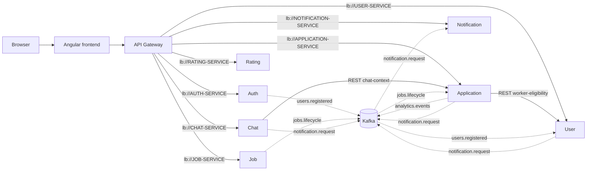
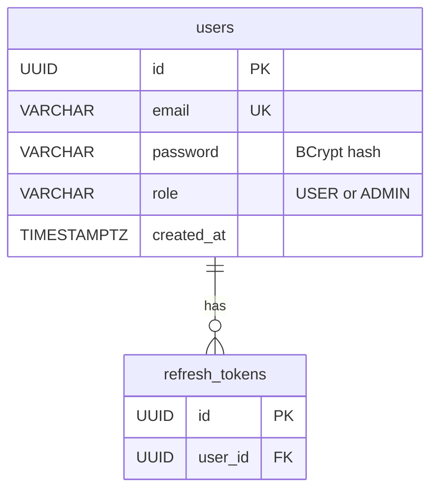
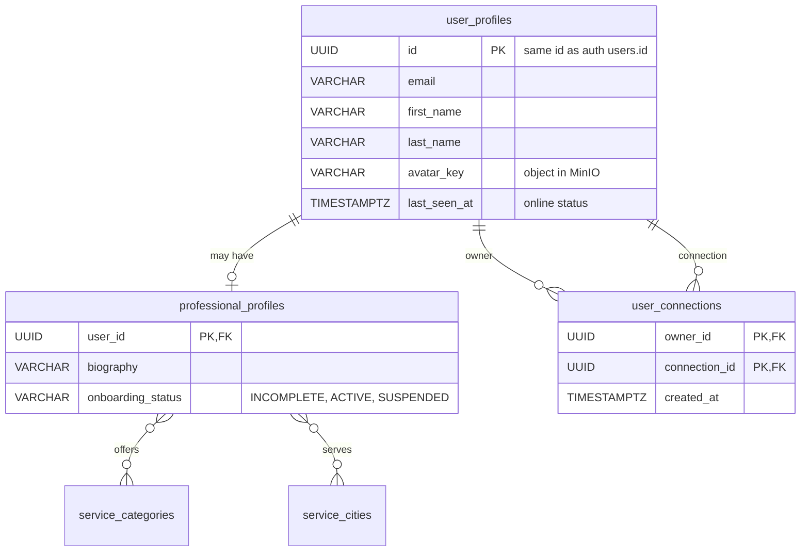
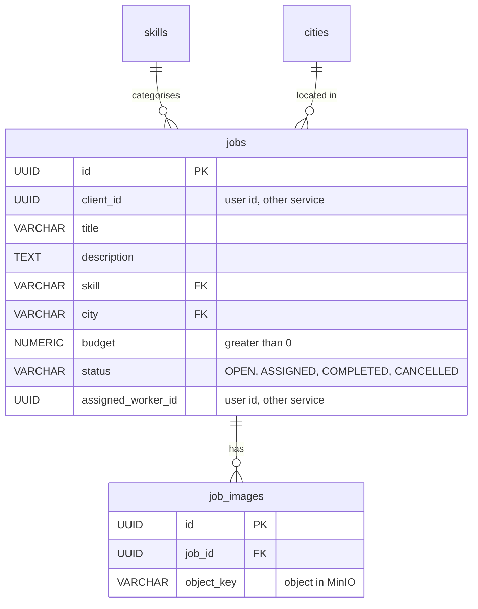
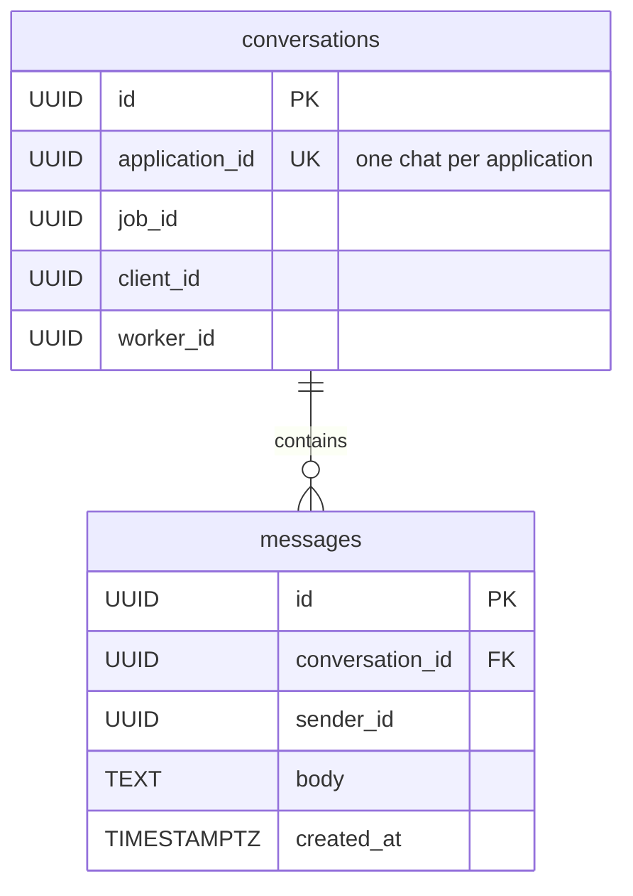

*This project has been created as part of the 42 curriculum by yrachidi, aelfadl, hboutale, isallali, ykhoussi.*

# 7irafi

## Description

**7irafi** is a Moroccan services marketplace that connects clients with local
professionals (plumbers, electricians, painters, …). A client posts a job; professionals
apply; the client picks one, they chat, the job is completed and both sides rate each
other.

One account can be both a client and a professional: "professional" is a profile
capability (with an onboarding status), not a separate kind of account.

### Key features

- Sign up / log in with email and password (BCrypt-hashed), short-lived JWT access
  tokens and rotating refresh tokens.
- User profiles with avatar upload, a professional profile (bio, skills, cities served),
  a professionals directory, connections (friends) and online status.
- Job posting with photos; search jobs with filters, sorting and pagination.
- Applications to jobs, with the client choosing one professional.
- Real-time chat between a client and a professional (WebSocket).
- Real-time notifications (WebSocket) and a notification bell.
- Ratings and reviews after a job.
- Personal analytics dashboard with live updates and date ranges.
- English, French and Arabic, with a right-to-left layout for Arabic.
- Public service status page, automated database backups and a tested restore procedure.
- Centralised logs (ELK) and metrics with alerting (Prometheus, Grafana, Alertmanager).

## Instructions

Run the following commands from the repository root. Install Docker with Compose
2.24.4 or later, Make, and OpenSSL 1.1.1 or later. Application dependencies are built
inside Docker.

### Configuration

Create the production environment file:

```bash
cp infra/docker/prod/.env.example infra/docker/prod/.env
```

The example defaults run a fresh local HTTPS demo at `https://127.0.0.1`.
To open it from another device, set `TLS_HOST_IP` to the host's reachable IPv4
address before starting. Use unique credentials and a JWT secret of at least
32 characters for a real deployment. Keep the existing credentials and Kafka
cluster ID when reusing volumes.

On macOS, set `OPENSSL_BIN` to your Homebrew OpenSSL executable if the system
version does not support the required certificate options.

Backend configuration files have no fallback values. Compose supplies each service's
settings explicitly; services run outside Docker need the environment variables
listed in their `environment` block.

### Run with HTTPS

```bash
make prod-up
```

This prepares a 365-day self-signed certificate, generates `.env.https`, initializes
the service databases, and builds and starts the production containers. Existing
certificates are reused while valid for the configured IP address. The generated
`.env.https` supplies the application and media origins; do not edit it manually.

Trust `infra/docker/prod/tls/server.crt` on each demo device so the browser can access
both the application and media over HTTPS. The certificate is self-signed, so browsers
do not trust it automatically.

Replace `<HOST_IP>` below with the value of `TLS_HOST_IP`:

| What | URL | Access |
| --- | --- | --- |
| Application | `https://<HOST_IP>` | an account you register |
| API base URL | `https://<HOST_IP>/api/` | used by the application |
| Status page | `https://<HOST_IP>/status` | public |
| Media (MinIO API) | `https://<HOST_IP>:9443` | signed file URLs supplied by the application |
| HTTP redirect | `http://<HOST_IP>:8088` | redirects application requests to HTTPS |

Nginx exposes the application, API, WebSockets, and media. The production overlay
keeps the direct backend, database, Kafka, Eureka, and MinIO console ports unpublished.

Use `make prod-ps` to check containers, `make prod-logs` to follow application logs,
and `make prod-down` to stop the stack while keeping its data volumes.

### Local development

Create the development environment file and start the stack:

```bash
make dev-init
make dev-up
```

The development frontend uses HTTP and the Angular development server:

| What | URL | Login |
| --- | --- | --- |
| Application | `http://localhost:4200` | an account you register |
| API Gateway | `http://localhost:8080` | — |
| Eureka dashboard | `http://localhost:8761` | — |
| Status page | `http://localhost:4200/status` | public |
| MinIO console | `http://localhost:9001` | `MINIO_ROOT_USER` / `MINIO_ROOT_PASSWORD` from `.env` |

### Logging and monitoring

The `observability` profile provides logging and monitoring. For development:

```bash
make dev-observability
```

For production, `make prod-up` starts logging and monitoring by default.
Configure Grafana, Elasticsearch, Kibana, and Logstash credentials in the
[production environment file](infra/docker/prod/.env.example). Use `make prod-down`
to stop the application and monitoring services while keeping their data volumes.

Use credentials from the `.env` file for the environment you started:

| What | URL | Login |
| --- | --- | --- |
| Grafana | `http://localhost:3000` | `GRAFANA_ADMIN_USER` / `GRAFANA_ADMIN_PASSWORD` from `.env` |
| Prometheus | `http://localhost:9090` | — |
| Alertmanager | `http://localhost:9093` | — |
| Kibana | `http://localhost:5601` | `elastic` / `ELASTIC_PASSWORD` from `.env` |

These monitoring and logging interfaces use HTTP and listen on `127.0.0.1` only;
open them on the machine running Docker.

## Team Information

| Login | Name | Role(s) | Responsibilities |
| --- | --- | --- | --- |
| yrachidi | Youssef Rachidi | Product Owner, Developer | Authentication (auth-service), user profiles and connections (user-service), API gateway, service discovery (Eureka); login, register, profile and professionals pages; i18n |
| aelfadl | Ayman Elfadl | Developer | Jobs (job-service), applications (application-service), Kafka messaging, MinIO file storage; jobs, my-jobs, create-job and applicants pages |
| hboutale | Hamza Boutaleb | Tech Lead, Developer | Ratings (rating-service), notifications (notification-service), conversations (chat-service); landing page, navbar, footer and shared UI; frontend BEM styling |
| isallali | Ismail Taha | Project Manager, Developer | DevOps: ELK logging, Prometheus/Grafana/Alertmanager monitoring, shared-kernel module, Makefile, production setup |
| ykhoussi | yasser khoussi | Developer | Analytics (analytics-service): dashboard projections, queries and live updates; account analytics dashboard |
## Project Management

- **Work organisation:** work was split by business area, matching the microservices:
  each member owned one or more services end to end (backend, database and the frontend
  pages that use it), so members could work in parallel without editing the same code.
  Shared pieces (gateway routes, Kafka topics, Docker Compose) were changed through pull
  requests that the owner of the affected service could review. The team met once a week
  to share progress, plan the next tasks and make decisions together.
- **Git workflow:** each task is developed on a separate branch (`feat/…`, `fix/…`,
  `refactor/…`, or `docs/…`). Changes are merged into `main` through GitHub pull
  requests. Commit messages follow Conventional Commits, such as
  `fix: correct API routing`.
- **Tools:** GitHub pull requests and code review; GitHub Issues for bugs (for example
  #40, a failing application-service test).
- **Communication:** Discord and WhatsApp, plus in-person syncs at 1337.

## Technical Stack

| Layer | Technology | Why we chose it |
| --- | --- | --- |
| Frontend | Angular 21 (standalone components, signals), TypeScript | A complete framework with routing, forms with validation, an HTTP client with interceptors and route guards built in, so the team did not have to pick and glue separate libraries. TypeScript catches type errors at build time. |
| Styling | Tailwind CSS v4, component CSS with BEM naming | Tailwind gives a shared set of spacing, colours and breakpoints, which makes responsive layouts quick. BEM class names keep each component's own CSS readable and stop styles from leaking between components. |
| Real-time client | STOMP over WebSocket (`@stomp/stompjs`) | Spring supports STOMP natively, and STOMP adds topics and subscriptions on top of a raw WebSocket, so the server can push a message to one user or one conversation. The client reconnects automatically. |
| Charts | Chart.js with ng2-charts | Covers line, bar and doughnut charts with tooltips out of the box; ng2-charts wraps it as Angular components. |
| Backend | Java 21, Spring Boot 4, Spring Security, Spring Data JPA | Spring Boot covers everything each service needs (REST, validation, security, database access, Kafka, WebSocket, health checks) with one consistent style, which keeps ten services alike. Java 21 is the current long-term support release. |
| Edge / discovery | Spring Cloud Gateway, Netflix Eureka, Spring Cloud LoadBalancer | One public entry point that validates JWTs; services find each other by name, not by address |
| Messaging | Apache Kafka 4 (KRaft, no ZooKeeper) | Asynchronous events so a slow consumer never delays the request that produced the event |
| Database | PostgreSQL 17, one database per service, Flyway migrations | The data is relational (users, jobs, applications, ratings) and needs constraints, foreign keys and transactions, which PostgreSQL provides; it is free and widely used. One database per service keeps each service the only owner of its data. Flyway makes every schema change a versioned, reviewable file. |
| File storage | MinIO (S3-compatible) | Avatars and job photos are stored outside the database |
| Logs | Elasticsearch, Logstash, Kibana 8.15 | With ten services, reading logs container by container does not work. ELK collects every service's logs in one place, searchable by request id across services. |
| Monitoring | Prometheus, Grafana, Alertmanager, node-exporter | Prometheus reads the metrics every Spring service already exposes through Actuator; Grafana shows them on dashboards; Alertmanager warns us when a service goes down or misbehaves. |
| Deployment | Docker Compose | One command starts the whole stack |

### Backend architecture



Every service registers in Eureka and owns its own database (`auth_db`, `user_db`,
`job_db`, `application_db`, `chat_db`, `notification_db`, `rating_db`, `analytics_db`).

The gateway is the public backend entry point. It validates JWTs for protected routes,
removes client-supplied trusted headers, and forwards requests by logical service name.
Auth owns credentials and token issuance; User owns profiles, the directory and avatars;
Job owns job listings; Application owns applications; Chat owns conversations;
Notification stores and pushes notifications; Rating owns reviews.
Each data-owning service owns its Flyway-managed schema and does not query another
service's tables.

Development uses one PostgreSQL container with separate logical databases. That is a
local-resource decision, not a claim that each service already has an independently
operated database server.

### Kafka topics

Local development includes a single-node KRaft Kafka broker reachable inside the
Docker network at `kafka:9092`, with persistent storage and automatic initialization
of four topics. Kafka has no published host port.

| Topic | Produced by | Consumed by |
| --- | --- | --- |
| `jobs.lifecycle` | job-service | application-service |
| `analytics.events` | job-service, application-service | analytics-service |
| `notification.request` | user-service, application-service, chat-service | notification-service |
| `users.registered` | auth-service | user-service |

Job-service, application-service and auth-service publish through database outboxes with
retries; job and application also keep ordering per entity. Application-service checks for
duplicate events and job versions.

## Database Schema

PostgreSQL, one database per service. Arrows are real foreign keys **inside** one
database. Ids that point into **another** service's database (for example
`jobs.client_id` → a user) are plain UUIDs with no foreign key: services never share
tables, so that link is kept by the application, not by the database.

#### `auth_db` — auth-service



#### `user_db` — user-service



#### `job_db` — job-service



#### `chat_db` — chat-service



Other tables, one per service database:

| Database | Table | Key fields |
| --- | --- | --- |
| `application_db` | `job_applications` | `id`, `job_id`, `applicant_id`, status, `version` |
| `notification_db` | `notifications` | `id`, `recipient_id`, `type`, `title`, `body`, `read_at` |
| `rating_db` | `ratings` | `id`, `job_id`, `rater_id`, `ratee_id`, `score` (1–5), `comment` |
| `analytics_db` | `analytics_jobs`, `analytics_applications` | read-only projections built from Kafka events |
| auth, job, application | `outbox_events` | events written in the same transaction as the data, then sent to Kafka |

## Features List

| Feature | Description |
| --- | --- |
| Registration and login | Email/password, BCrypt, JWT access token + rotating refresh token |
| API gateway and service discovery | Single public entry point, JWT check, trusted identity headers, Eureka routing |
| User profile and avatar | Edit profile, upload avatar (default avatar if none) |
| Professional profile and directory | Bio, skills, cities, onboarding status; browse professionals |
| Connections and online status | Add/remove connections, see who is online |
| Jobs | Post, edit, cancel jobs with photos; search with filters, sorting, pagination |
| Applications | Apply to a job; client accepts one applicant |
| Chat | Real-time messages between client and professional |
| Notifications | Real-time notification bell |
| Ratings | Rate the other side after a job |
| Analytics dashboard | Personal activity charts, live updates, date ranges, filters, export |
| Internationalisation | English, French, Arabic (RTL) |
| Status page, backups, recovery | Live service health, scheduled dumps, tested restore |
| Logs and monitoring | ELK, Prometheus, Grafana, Alertmanager |
| Privacy Policy and Terms of Service | Linked from the footer |

## Modules

| # | Module (subject section) | Type | Points |
| --- | --- | --- | --- |
| 1 | Web — Framework for frontend and backend (Angular + Spring Boot) | Major | 2 |
| 2 | Web — Real-time features with WebSockets | Major | 2 |
| 3 | Web — User interaction: chat, profiles, friends | Major | 2 |
| 4 | User Management — Standard user management and authentication | Major | 2 |
| 5 | Devops — Backend as microservices | Major | 2 |
| 6 | Devops — Log management with ELK | Major | 2 |
| 7 | Devops — Monitoring with Prometheus and Grafana | Major | 2 |
| 8 | Data and Analytics — Advanced analytics dashboard with data visualization | Major | 2 |
| | **Majors subtotal (required 14)** | | **16** |
| 9 | Web — Use an ORM (Spring Data JPA / Hibernate) | Minor | 1 |
| 10 | Web — Advanced search with filters, sorting and pagination | Minor | 1 |
| 11 | Accessibility — Multiple languages (EN, FR, AR) | Minor | 1 |
| 12 | Accessibility — Right-to-left language support (Arabic) | Minor | 1 |
| 13 | Devops — Health check, status page, backups and disaster recovery | Minor | 1 |
| | **Total claimed** | | **21** |

The subject caps the bonus at 5 points, so 19 is the maximum score. We claim a little more
in case one module is not validated.

### 1. Framework for frontend and backend — Major

- **Why:** a framework on each side gives the team shared conventions, so ten services
  and many pages written by five people still look and work alike.
- **How:** Angular 21 frontend (standalone components, signals, router, reactive forms,
  HTTP interceptors); every backend service is a Spring Boot application.

### 2. Real-time features with WebSockets — Major

- **Why:** chat, notifications and dashboard figures must reach users without a page reload.
- **How:** STOMP over WebSocket in chat-service, notification-service and
  analytics-service; the client uses `@stomp/stompjs`.
- **Broadcasting:** each service runs a STOMP broker (`/topic`, `/queue`) and sends to
  one user with `convertAndSendToUser`, so a message only reaches the people concerned.
- **Connection and disconnection:** the client reconnects automatically after 3 seconds
  and exchanges heartbeats every 10 seconds, so a dropped connection is noticed and
  restored without a page reload. A browser cannot send an `Authorization` header when
  opening a WebSocket, so the client sends the JWT on the STOMP `CONNECT` frame; the
  server checks it once and ties the user to the session.

### 3. User interaction — Major

- **Why:** a client and a professional must be able to talk and find each other.
- **How:** chat-service (conversations and messages), profile pages, and connections
  stored in `user_connections`.
- **Chat:** real-time messages over WebSocket, saved in `chat_db` so the history stays.
- **Profiles:** public profile and professional profile pages.
- **Friends:** add, remove and list connections
  (`GET`, `POST`, `DELETE /users/me/connections/{id}`).

### 4. Standard user management and authentication — Major

- **Why:** every marketplace feature depends on knowing who the user is and letting
  them present themselves to the other side.
- **How:** profile editing; avatar upload checked by size and by file signature (PNG,
  JPEG, WebP) and stored in MinIO, with a default avatar; connections; online status from
  `last_seen_at`; a public profile page.

### 5. Backend as microservices — Major

The module requires loosely coupled services with clear interfaces, REST APIs or message
queues for communication, and a single responsibility for each service.

| Requirement | Evidence in 7irafi |
| --- | --- |
| Focused responsibilities | Auth handles credentials/tokens, User handles profiles, Job handles jobs, Application handles applications, Chat handles conversations, Notification handles notifications, Rating handles reviews, Gateway handles the edge boundary, and Eureka handles discovery. |
| Clear interfaces | The gateway exposes `/auth/**`, `/users/**`, `/jobs/**`, `/applications/**`, `/conversations/**`, `/notifications/**`, `/ratings/**` and `/analytics/**`. Services call each other only through `/internal/**` endpoints protected by `X-Internal-Api-Key`. |
| Loose location coupling | Gateway routes use `lb("…-SERVICE")`; Application and Rating call `http://USER-SERVICE` through a `@LoadBalanced RestClient.Builder`, not a container address. |
| Independent data ownership | Every service has its own database and Flyway migrations. No cross-service table access is used. |
| Runtime discovery and load balancing | Every running service registers in Eureka. User Service can run as multiple replicas and is selected by Spring Cloud LoadBalancer. |
| Message queue | Kafka carries `jobs.lifecycle`, `analytics.events`, `notification.request` and `users.registered`, so a slow consumer never delays the request that produced the event. |

Services use REST where the caller needs an answer now (eligibility, chat context)
and Kafka where it does not (registration, notifications, analytics, job lifecycle).

### 6. Log management with ELK — Major

- **Why:** with ten services, finding one error means searching every container's logs.
  ELK puts them all in one searchable place.
- **How:** every service writes JSON logs with its name and a request id (from the
  shared-kernel module). Logstash reads the Docker log files, keeps only 7irafi service
  logs and sends them to Elasticsearch (`7irafi-logs-*`); Kibana shows them.
- **Retention and archiving:** an index lifecycle policy (`7irafi-logs-policy`) keeps
  logs hot, compacts them after 2 days and deletes them after `LOG_RETENTION_DAYS`
  (default 7).
- **Secure access:** Elasticsearch security is on. Kibana and Logstash use their own
  users and passwords from `.env`; Logstash's user can only write to the log indices.
  Kibana listens on `127.0.0.1` only.

### 7. Monitoring with Prometheus and Grafana — Major

- **Why:** logs say what happened; metrics show when a service is slow, failing or
  running out of memory, before users notice.
- **Metrics and exporters:** Prometheus scrapes each Spring service's
  `/actuator/prometheus` endpoint, plus node-exporter for the host (CPU, memory, disk).
- **Custom dashboard:** `7irafi overview`, provisioned from
  `infra/docker/grafana/dashboards/`: request rate, 4xx/5xx errors, latency
  p50/p95/p99, JVM heap, CPU, GC pauses, database pool, jobs posted, applications, and
  login/upload failures.
- **Alerting:** six rules in `alerts.yml` (ServiceDown, HighErrorRate, HighLatency,
  DatabasePoolExhausted, HighJvmMemory, DiskPressure), routed through Alertmanager.
- **Secure access:** Grafana admin user and password from `.env`, sign-up disabled,
  bound to `127.0.0.1`.

### 8. Advanced analytics dashboard with data visualization — Major

- **Why:** clients and professionals want to see their own activity over time (jobs
  posted, applications, results) to make decisions.
- **How:** analytics-service builds per-user projections from `analytics.events` and
  `jobs.lifecycle`; the dashboard shows them with Chart.js and is updated live over
  STOMP/WebSocket.

| Requirement | Evidence |
| --- | --- |
| Interactive charts | Chart.js (ng2-charts) on the dashboard |
| Real-time data updates | Live STOMP connection to analytics-service |
| Customizable date ranges and filters | Start and end date, and grouping by day, week or month; invalid ranges are rejected |
| Export functionality | "Download CSV" button on the dashboard: exports the jobs and applications shown for the selected date range and grouping, as `analytics-<start>-to-<end>-<granularity>.csv` |

### 9–13. Minor modules

- **ORM:** Spring Data JPA / Hibernate entities; Flyway owns the schema and Hibernate
  only validates it (`ddl-auto=validate`).
- **Advanced search:** `GET /jobs` filters by skill, city, status, budget range,
  duration and preferred time, each a JPA `Specification` combined only when given;
  sorting (default newest first) and pagination (max 20 per page).
- **Multiple languages:** English, French and Arabic translation files (`src/app/i18n/`),
  a language switcher in the UI, and the choice remembered in the browser.
- **RTL support:** choosing Arabic sets `<html dir="rtl">`; the layout uses Tailwind's
  logical properties, so it mirrors instead of only right-aligning the text.
- **Health check, status page, backups and recovery:** a public status page
  (`/status`) checks every service registered in Eureka; `db-backup` dumps each database
  on a schedule with retention; a restore script brings one database back, tested end
  to end.

## Resources

### References

- [Angular documentation](https://angular.dev)
- [Spring Boot reference](https://docs.spring.io/spring-boot/)
- [Spring Cloud Gateway](https://docs.spring.io/spring-cloud-gateway/reference/)
- [Spring Cloud Netflix Eureka](https://docs.spring.io/spring-cloud-netflix/reference/)
- [Apache Kafka documentation](https://kafka.apache.org/documentation/)
- [Transactional outbox pattern](https://microservices.io/patterns/data/transactional-outbox.html)
- [Flyway documentation](https://documentation.red-gate.com/flyway)
- [Tailwind CSS](https://tailwindcss.com/docs)
- [OWASP Password Storage Cheat Sheet](https://cheatsheetseries.owasp.org/cheatsheets/Password_Storage_Cheat_Sheet.html)

### How AI was used

- **yrachidi:**
  - **Translations:** drafting the French and Arabic versions of the interface text
    from the English, then reviewing them.
  - **Styling:** help with the Tailwind and CSS layout of the pages, including the
    responsive and right-to-left versions.
  - **Learning:** explaining new concepts (Spring Security, JWT, Kafka, the outbox
    pattern, Angular signals) and the reasons behind design choices, so the code could
    be written and explained without help.
- **aelfadl (Ayman ELFADL):**
  - **Learning:** Used AI to learn frontend and backend concepts, including Angular,
    TypeScript, Java, and Spring Boot.
  - **Styling:** Used AI for help with CSS, Tailwind CSS, and component layouts on
    frontend pages.
- **hboutale (Hamza Boutaleb):**
  - **Learning:** Used AI to learn Angular, TypeScript, Spring Boot, and Tailwind CSS.
  - **Styling:** Used AI for repetitive frontend work, including moving Tailwind utility classes from Angular templates into BEM-organized component styles while continuing to use Tailwind CSS.
- **isallali (Ismail Taha):**
  - **Learning:** Used AI to learn DevOps and understand how to use Grafana, the ELK stack, and Prometheus for project monitoring and logging.
  - **DevOps tasks:** Used AI to reduce repetitive work while setting up the project's DevOps tooling.
- **ykhoussi:** explaining new concepts (STOMP, WebSockets, JDBC, Spring Boot).
