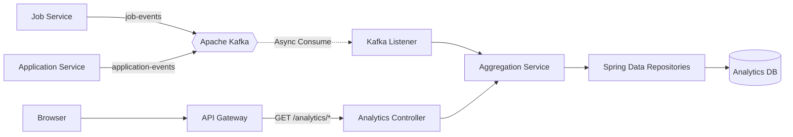

# Analytics Service

**Service Owner:** Yasser Khoussi (7irafi)  
**Module Target:** Advanced Analytics Dashboard (Data and Analytics)  

---

## 1. Architecture & Design Patterns

This microservice implements **CQRS (Command Query Responsibility Segregation)** and **Event-Driven Architecture** to power the Advanced Analytics Dashboard. 

*   **Database Isolation:** Analytics queries bypass the core transactional databases (`job-service`, `application-service`) to prevent OLTP performance degradation.
*   **Read-Optimized (OLAP):** Data is flattened and denormalized via asynchronous event consumption, creating an optimized schema for heavy time-series filtering.
*   **Timezone Enforcement:** Time-series aggregations utilize native PostgreSQL `DATE_TRUNC` with `AT TIME ZONE 'Africa/Casablanca'` to strictly enforce reporting timezone compliance at the database level.

---

## 2. Messaging Infrastructure (Apache Kafka)

The service acts as a downstream consumer for core platform events to build its materialized views. Serialized via Spring Kafka `JsonDeserializer`.

| Topic | Trigger | Target Action |
| :--- | :--- | :--- |
| `job-events` | `JOB_CREATED` | Inserts/Updates records in `analytics_jobs` |
| `application-events` | `APP_SUBMITTED` | Inserts/Updates records in `analytics_applications` |

---

## 3. Database Schema & Migrations

Database state and migrations are managed via **Flyway**. To prevent ledger conflicts with other microservices in local development, this service utilizes an isolated ledger (`flyway_schema_history_analytics`) with `baseline-on-migrate: true`.

### 3.1 `analytics_jobs`
| Column | Type | Attributes |
| :--- | :--- | :--- |
| `job_id` | UUID | Primary Key |
| `client_id` | UUID | Indexed |
| `status` | VARCHAR | Indexed |
| `skill` | VARCHAR | Indexed |
| `city` | VARCHAR | Indexed |
| `created_at` | TIMESTAMPTZ | Indexed |

### 3.2 `analytics_applications`
| Column | Type | Attributes |
| :--- | :--- | :--- |
| `application_id` | UUID | Primary Key |
| `job_id` | UUID | Foreign Reference |
| `applicant_id` | UUID | Indexed |
| `status` | VARCHAR | Derived Status, Indexed |
| `job_skill` | VARCHAR | Indexed |
| `job_city` | VARCHAR | Indexed |
| `submitted_at` | TIMESTAMPTZ | Indexed |

---

## 4. API & Real-Time Sync

### 4.1 REST Endpoints
*   `GET /analytics/my/jobs` - Aggregated metrics, activity buckets, status distribution, and paginated records for the authenticated client.
*   `GET /analytics/my/applications` - Aggregated metrics, activity buckets, status distribution, and paginated records for the authenticated applicant.
*   *Query Parameters:* `from`, `to`, `granularity` (day/week/month), `status`, `skill`, `city`, `page`, `size`.

### 4.2 WebSocket Invalidation (STOMP)
To achieve sub-5-second dashboard updates across active sessions:
*   **Connection:** `/ws/analytics`
*   **Destination:** `/queue/analytics-{userId}`
*   **Flow:** Kafka Consumer processes event -> DB persists data -> Service broadcasts invalidation payload (`eventId`, `resource`, `occurredAt`) -> Frontend seamlessly refetches HTTP aggregates.

---

## 5. Testing Strategy

The test suite validates the asynchronous, event-driven flow using isolated integration environments.

*   **Frameworks:** `@SpringBootTest`, `@EmbeddedKafka`
*   **Execution:** Test lifecycles manage dedicated Kafka consumer states and enforce transactional database teardowns (`repository.deleteAll()`) to guarantee strict state isolation across asynchronous runs.

```bash
# Execute integration test suite
mvn test -Dtest=AnalyticsEventListenerTest
```

## 6. System Architecture Diagram

