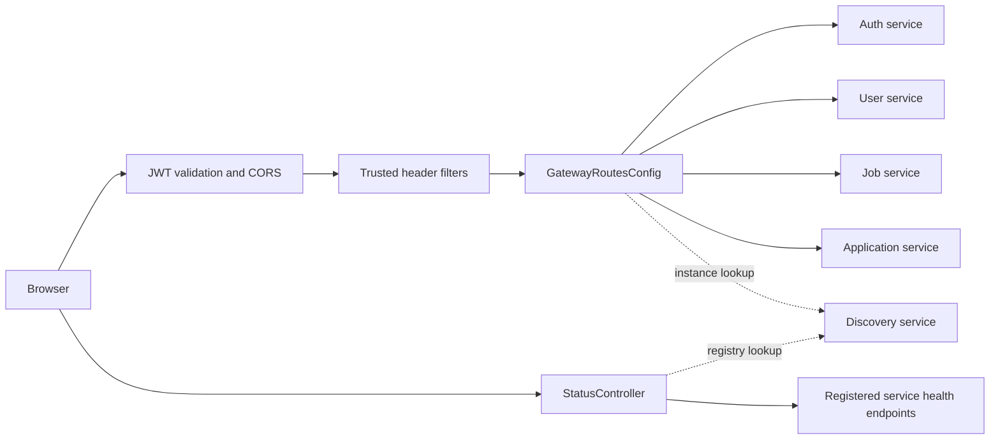
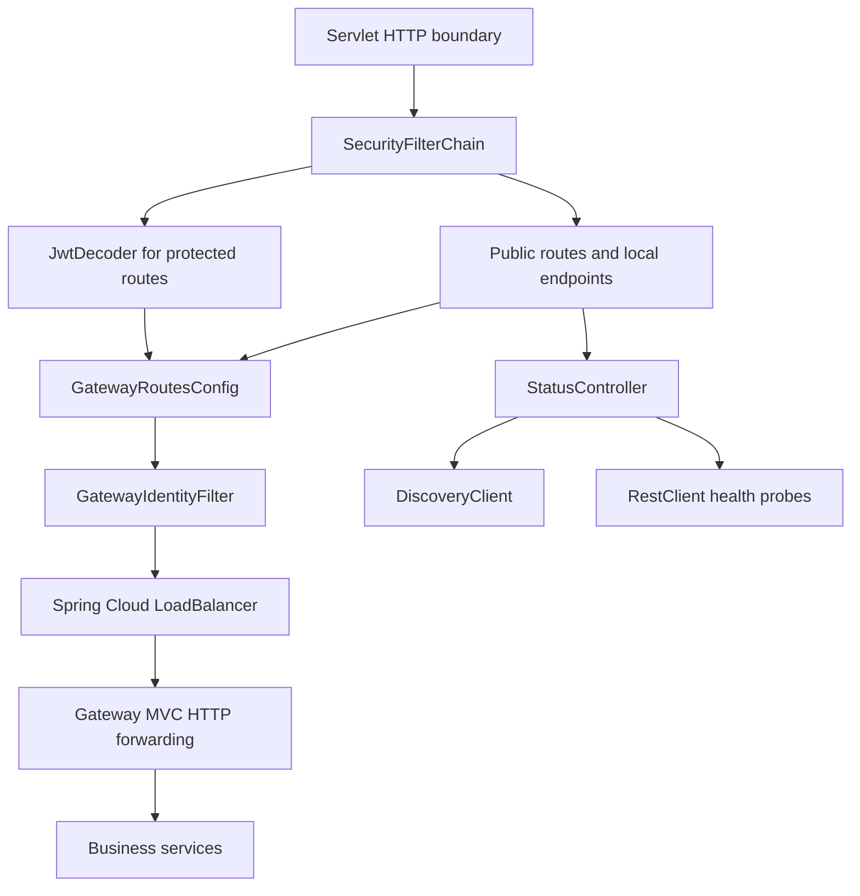
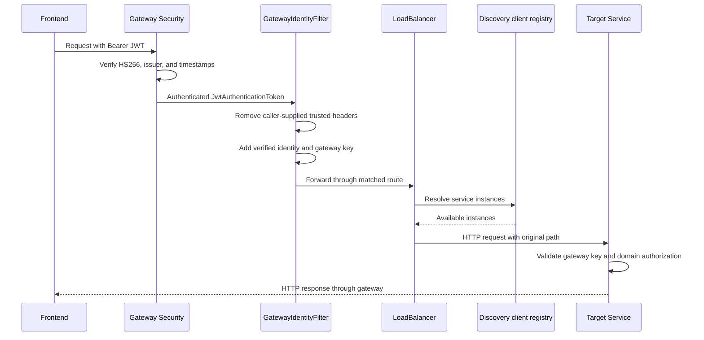
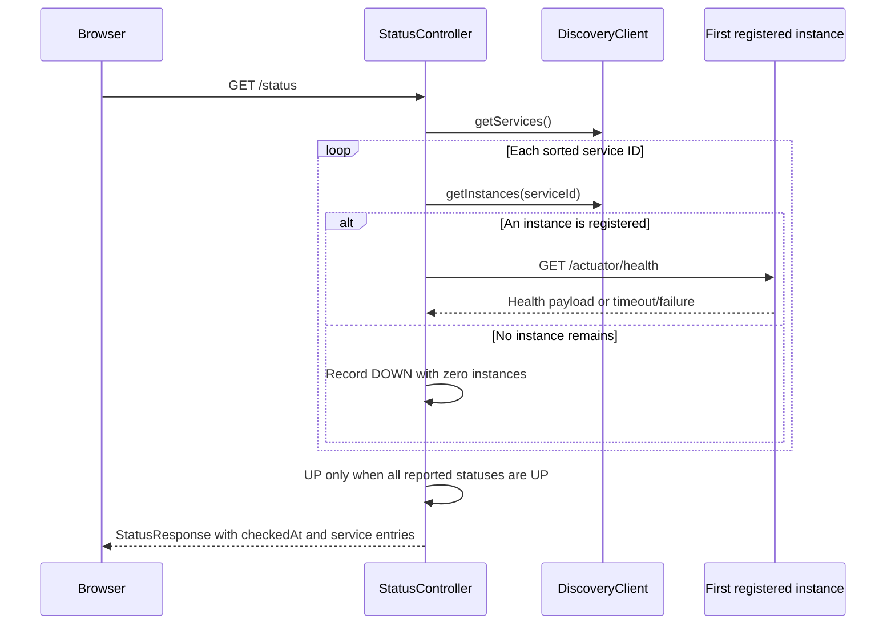
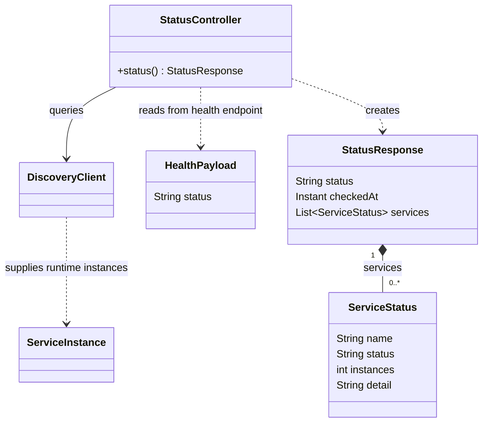

# API Gateway: End-to-End Architecture

This document traces the current implementation from its HTTP boundary through
authorization, service behavior, data relationships, and runtime dependencies.
The numbered structure follows [Job Service: End-to-End Architecture](../../docs/development/job-service-architecture.md).

## 1. Responsibility

`api-gateway` is the browser-facing backend entry point. It validates access tokens, sets trusted
identity headers, applies CORS rules, and routes requests to service instances discovered through
Eureka. It also serves the platform status endpoint.

The gateway uses Java 21, Spring Boot 4, Spring Cloud Gateway Server Web MVC, Spring Security's
OAuth2 resource server, Eureka, and Spring Cloud LoadBalancer. It is a servlet/MVC application.
Its default port is `8080`; it registers as `api-gateway` and has no database.

## 2. System Context

Business traffic uses the gateway on port `8080`. The gateway discovers service instances
through Eureka and forwards the original route path to the selected service.

## 3. Layered Architecture

Source root: [src/main/java/com/herafi/api_gateway](src/main/java/com/herafi/api_gateway).

| Component | Responsibility |
| --- | --- |
| `config/GatewayRoutesConfig` | Functional MVC routes and load-balanced service destinations. |
| `config/SecurityConfig` | Stateless access rules and CORS configuration. |
| `config/JwtConfig` | HS256 decoder, minimum secret length, issuer and token validation. |
| `filter/GatewayIdentityFilter` | Strip caller-supplied trusted headers and inject verified identity. |
| `status/StatusController` | Registry-based service health probes and aggregate status response. |

There is no repository or JPA layer. Route definitions are Java configuration beans. Security
validates caller identity; route filters build trusted downstream headers; the load balancer
selects destinations. `StatusController` is a separate local controller with typed response records.

## 4. Public API

| Path pattern | Eureka destination | Access and forwarding |
| --- | --- | --- |
| `/auth/**` | `AUTH-SERVICE` | Permit unauthenticated access; strip trusted headers. |
| `/users/**` | `USER-SERVICE` | Require a JWT; inject identity and gateway key. |
| `/jobs/**` | `JOB-SERVICE` | Require a JWT; inject identity and gateway key. |
| `/applications/**` | `APPLICATION-SERVICE` | Require a JWT; inject identity and gateway key. |

Paths are forwarded without a prefix rewrite. `/internal/**` has no gateway route; service-to-service
clients call internal endpoints directly.

| Method / path | Local behavior |
| --- | --- |
| `GET /status` | Return aggregate and per-service health information. |
| `GET /actuator/health` | Return the gateway's own health. |
| `/swagger-ui/**`, `/v3/api-docs/**` | Local OpenAPI tooling paths permitted by security. |
| `OPTIONS /**` | CORS preflight permitted by security. |

The forwarding routes match path patterns rather than explicitly enumerating methods. The
destination controller owns method-specific contracts. Local OpenAPI tooling is not configured
to aggregate all downstream service specifications.

## 5. Authenticated Request Flow

For an authenticated route:

1. Spring Security verifies the Bearer token signature, issuer, and validity period.
2. `GatewayIdentityFilter` removes `X-User-Id`, `X-User-Email`, `X-User-Role`, `X-Gateway-Key`, and
   `X-Internal-Api-Key` supplied by the caller.
3. It sets `X-User-Id` from the JWT subject, `X-User-Email` and `X-User-Role` from claims, and
   `X-Gateway-Key` from server configuration.
4. The route's load-balancer filter selects a registered destination instance and proxies the request.

Business services validate the shared gateway key before trusting these headers. Resource ownership
and domain rules are enforced in those services. Worker eligibility is determined by user-service's
professional profile, not by a gateway role check.

## 6. Identity Headers and Privacy

`GatewayIdentityFilter` removes all five headers below before forwarding any auth or business
request. On business routes it replaces four with server-controlled values:

| Header | Forwarded source on authenticated routes |
| --- | --- |
| `X-User-Id` | JWT subject. |
| `X-User-Email` | JWT `email` claim. |
| `X-User-Role` | JWT `role` claim. |
| `X-Gateway-Key` | `GATEWAY_SHARED_SECRET`. |
| `X-Internal-Api-Key` | Removed; not injected. |

Auth routes only strip these headers. The incoming `Authorization` header is not removed by this
filter. Downstream ownership checks use the verified identity; possession of an arbitrary user
header does not establish identity. The gateway does not load user profiles or job ownership data.

## 7. Security and Routing Rules

`SecurityConfig` permits `OPTIONS` requests, `/auth/**`, `/actuator/health`, `/status`,
`/swagger-ui/**`, and `/v3/api-docs/**` without authentication. The business route groups above
require authentication. Sessions and CSRF protection are disabled.

HS256 verification uses the same `JWT_SECRET` and `JWT_ISSUER` as
[auth-service](../auth-service/architecture.md). Startup rejects secrets shorter than 32 UTF-8 bytes.
CORS allows one configured frontend origin, credentials, `Authorization` and `Content-Type`
headers, and the `GET`, `POST`, `PUT`, `PATCH`, `DELETE`, and `OPTIONS` methods.

The gateway is stateless: login state is carried in the token, not a server session. Route
definitions and authorization matchers must both be updated when adding a protected route group.
No public route exposes `/internal/**`.

`addAuthenticatedIdentity` requires a `JwtAuthenticationToken`; using it outside an authenticated
route raises an `IllegalStateException`. Resource-level owner/admin checks remain in the target
service. All business route groups require authentication, including read-only catalog routes.

## 8. Discovery and Status Probes

`GET /status` reads the registry, sorts service names, and probes the first instance of each service
at `/actuator/health`. Each probe has a two-second connection timeout and two-second read timeout.
The response includes a timestamp, registered instance counts, individual statuses, and aggregate
`UP` or `DEGRADED`. Probes run sequentially. This is a sample of registered services: it does not
test every instance or maintain an expected-service inventory. An empty registry produces `UP`.

An unavailable probe becomes a `DOWN` entry with the exception class name in `detail`.
A null response body becomes `UNKNOWN`. This endpoint returns a JSON health summary rather
than throwing each dependency failure back to the browser.

## 9. Persistence Model and Runtime Relationships

The gateway has no persistent entities, database tables, or Flyway migrations. Its data
relationships are response records and runtime service references. The Mermaid class diagram
below describes the actual records nested in `StatusController`; it is not a database ER model.

One `StatusResponse` contains zero or more `ServiceStatus` values. Each value represents a
service name and reports its registered instance count; only one instance is probed. `HealthPayload`
is a private DTO for the target's response. None of these records is a JPA entity.

Routes, JWT decoder configuration, and shared-key values live in application configuration.
Discovery caches are managed by the Eureka client rather than stored in an application database.

## 10. Error Boundary

The gateway has no custom `GlobalExceptionHandler` or shared business-error DTO. Spring
Security handles authentication failures before forwarding; Gateway MVC handles routing/transport
failures; downstream HTTP responses retain their service-specific contracts.

| Boundary | Behavior |
| --- | --- |
| Missing/invalid/expired JWT on a protected route | Request rejected by Spring Security before forwarding. |
| Invalid browser origin/preflight | Evaluated by the CORS configuration. |
| No matching/exposed route | No configured business forwarding target. |
| Missing authenticated JWT during identity injection | `IllegalStateException`; indicates misuse of the route filter. |
| Downstream service returns a domain error | Its status/body is returned through the proxy. |
| Status probe fails | `DOWN` in the status payload; the aggregate becomes `DEGRADED`. |

Auth/user errors and job/application errors have different JSON shapes; the gateway does not
normalize them into one envelope.

## 11. Configuration and Local Runtime

Configuration source: [application.properties](src/main/resources/application.properties).

| Environment variable | Purpose / default |
| --- | --- |
| `SERVER_PORT` | HTTP port; `8080`. |
| `JWT_SECRET` | Required token-verification secret. |
| `JWT_ISSUER` | Expected issuer; `7irafi-auth-service`. |
| `GATEWAY_SHARED_SECRET` | Required key sent to business services. |
| `FRONTEND_ORIGIN` | Allowed browser origin; `http://localhost:4200`. |
| `DISCOVERY_SERVICE_URL` | Eureka endpoint; `http://localhost:8761/eureka/`. |

Run `mvn spring-boot:run` from this directory with discovery and target services available.
The [Compose configuration](../../infra/docker/docker-compose.yml) publishes port `8080` and
waits for the four business services and discovery-service to become healthy before starting it.
Actuator exposes the gateway's own health at `/actuator/health`.

Run `mvn test`. Existing tests cover context startup, application-route matching, PATCH preflight,
trusted-header removal, JWT-derived identity, and rejection of identity injection without a JWT.
See [src/test/java/com/herafi/api_gateway](src/test/java/com/herafi/api_gateway).

## 12. Developer Change Guide

1. Add route definitions in `GatewayRoutesConfig` with the matching Eureka service ID.
2. Update `SecurityConfig` alongside new route groups.
3. Apply identity injection to authenticated business routes and header stripping to public auth routes.
4. Keep internal API keys out of browser-forwarded requests.
5. Coordinate JWT claim/issuer/secret changes with auth-service.
6. Keep business ownership and lifecycle rules in their owning services.

Run `mvn test`. Existing tests exercise application routes, PATCH preflight, trusted-header
stripping, identity injection, missing-JWT rejection, and application context startup.

## 13. Open Decisions and Risks

- `/status` does not maintain an expected-service inventory; an empty registry produces `UP`.
- A single healthy probe can conceal failures in other instances of the same service.
- Sequential probes make total status latency grow with service count and individual timeouts.
- JWT verification and trusted headers depend on consistent shared secrets across services.
- No application-level rate limiter, custom retry policy, or circuit breaker is configured here.

## 14. Source Map

Java source root: [src/main/java/com/herafi/api_gateway](src/main/java/com/herafi/api_gateway).

| Concern | Primary files |
| --- | --- |
| Routes and load balancing | [config/GatewayRoutesConfig.java](src/main/java/com/herafi/api_gateway/config/GatewayRoutesConfig.java) |
| Authorization and CORS | [config/SecurityConfig.java](src/main/java/com/herafi/api_gateway/config/SecurityConfig.java) |
| JWT verification | [config/JwtConfig.java](src/main/java/com/herafi/api_gateway/config/JwtConfig.java) |
| Trusted headers | [filter/GatewayIdentityFilter.java](src/main/java/com/herafi/api_gateway/filter/GatewayIdentityFilter.java) |
| Status and runtime DTOs | [status/StatusController.java](src/main/java/com/herafi/api_gateway/status/StatusController.java) |
| Startup | [ApiGatewayApplication.java](src/main/java/com/herafi/api_gateway/ApiGatewayApplication.java) |

Runtime properties: [application.properties](src/main/resources/application.properties).
