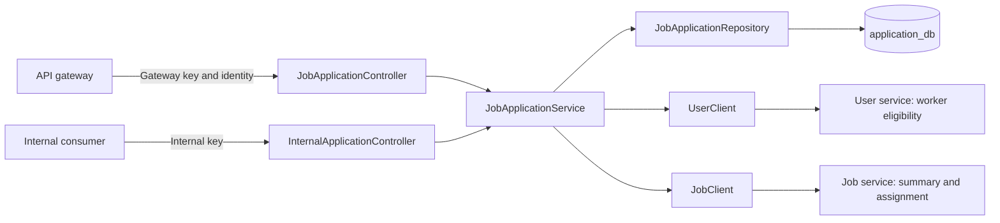
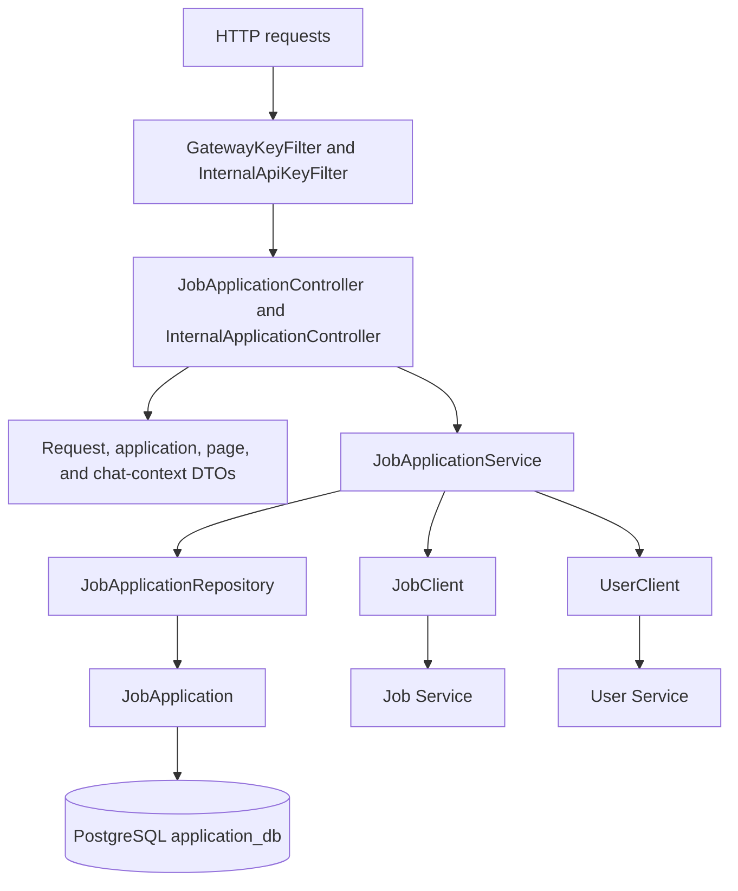
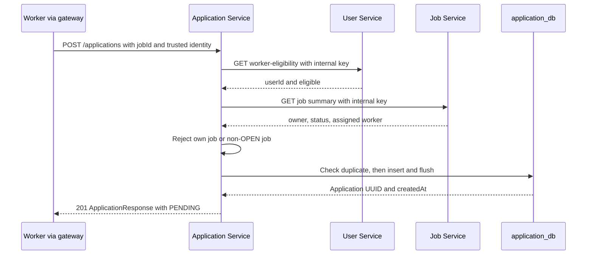
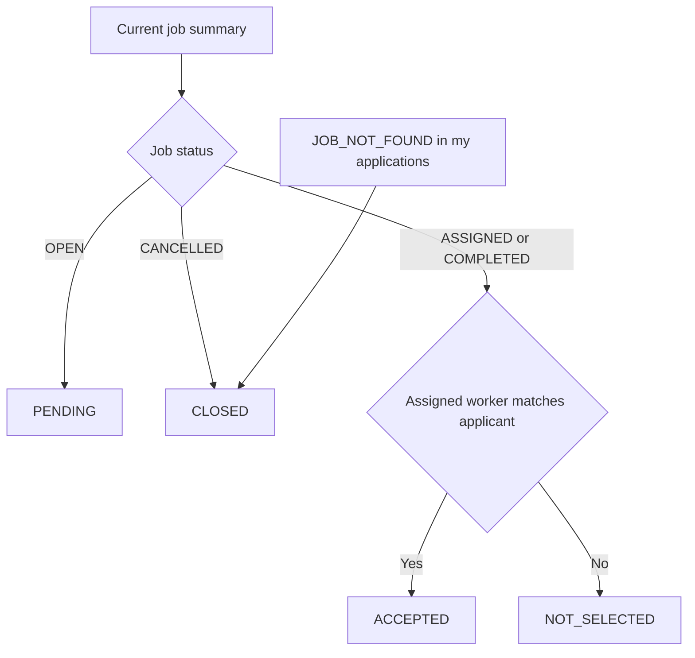
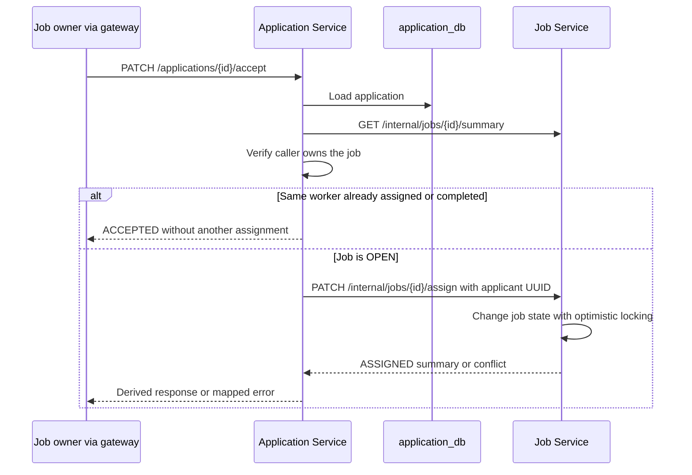
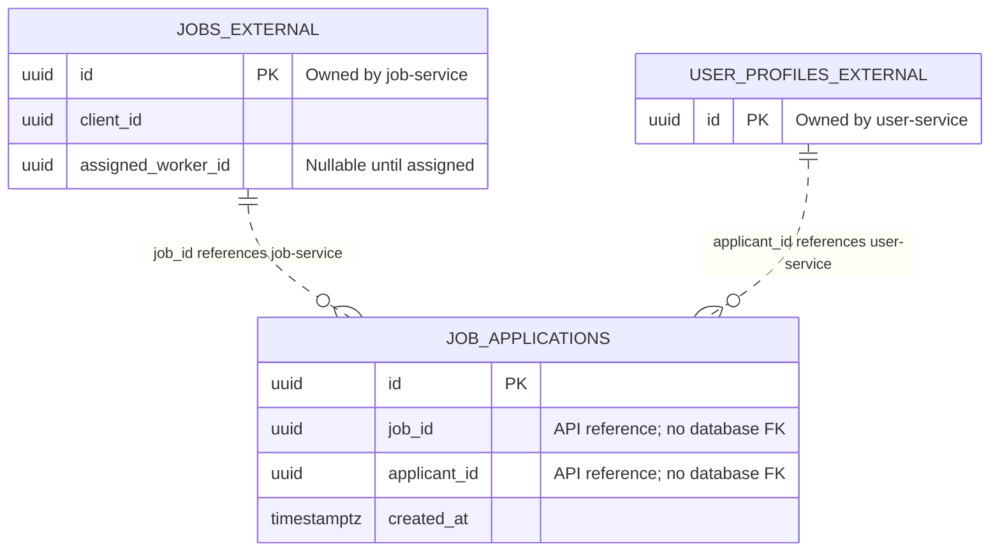

# Application Service: End-to-End Architecture

This document traces the current implementation from its HTTP boundary through
authorization, service behavior, data relationships, and runtime dependencies.
The numbered structure follows [Job Service: End-to-End Architecture](../../docs/development/job-service-architecture.md).

## 1. Responsibility

`application-service` owns the record that a worker applied to a job. It verifies worker eligibility,
lists applications, coordinates applicant acceptance, and exposes application context for internal
chat consumers. Job lifecycle and assignment remain owned by [job-service](../job-service/architecture.md).

The service uses Java 21, Spring Boot 4, Spring MVC, Bean Validation, Spring Data JPA, Flyway,
PostgreSQL, and Eureka. It defaults to port `8084`, registers as `application-service`, and owns
`application_db`. Dependency versions are in [pom.xml](pom.xml).

## 2. System Context



## 3. Layered Architecture



Source root: [src/main/java/com/herafi/application_service](src/main/java/com/herafi/application_service).

| Package | Responsibility |
| --- | --- |
| `controller` | Public apply/list/accept operations and internal chat-context reads. |
| `service` | `JobApplicationService` authorization, orchestration, and derived statuses. |
| `client` | Synchronous `JobClient` and `UserClient`, response validation, and failure translation. |
| `entity`, `repository` | `JobApplication` persistence, uniqueness, and paginated queries. |
| `config` | Gateway/internal key filters and unauthorized-response writer. |
| `dto`, `exceptions` | Request/response records and structured API errors. |

Controllers bind trusted user UUIDs and validate bodies/pagination. The service decides ownership,
application uniqueness, acceptance, and status projection. Clients validate dependency response
IDs and required fields before exposing them to business logic. `ApplicationSubmissionService`
owns the local application/outbox transaction after HTTP checks. `JobLifecycleEventHandler`
owns the inbox, outcome, and outbox transaction. Neither transaction spans a remote HTTP call.

## 4. Public API

The gateway requires a JWT for `/applications/**`. `GatewayKeyFilter` checks `X-Gateway-Key`
for `/applications` and nested paths; controller methods use the trusted `X-User-Id` header.
`InternalApiKeyFilter` separately checks `X-Internal-Api-Key` on `/internal` and nested paths.
The service does not decode JWTs or treat the JWT role as proof of worker eligibility.

| Method | Path | Purpose |
| --- | --- | --- |
| `POST` | `/applications` | Apply using a body containing `jobId`; return `201`. |
| `GET` | `/applications/my` | Page through the caller's applications. |
| `GET` | `/applications/job/{jobId}` | Job owner reads applications for that job. |
| `PATCH` | `/applications/{applicationId}/accept` | Job owner accepts an applicant through job-service. |
| `GET` | `/internal/applications/{applicationId}/chat-context` | Return application/job IDs, applicant, client, and derived status. |
| `GET` | `/actuator/health` | Service health. |

List endpoints use zero-based pages, default size 10, maximum size 20, and descending
`createdAt`/`id` ordering. Responses are DTOs or `PageResponse` directly. The chat-context endpoint
supplies metadata; it does not store messages or implement a chat transport.

## 5. Application Creation

`POST /applications` accepts only the target job UUID:

```json
{"jobId": "8ec07324-43ed-48fb-b650-8e147020728d"}
```

The applicant is the gateway-provided `X-User-Id`; the client cannot select a different applicant.

1. `UserClient` calls `/internal/users/{id}/worker-eligibility` and requires an active professional.
2. `JobClient` reads `/internal/jobs/{id}/summary`.
3. Reject an application to the caller's own job (`403`) or a non-open job (`409`).
4. Lock the local per-job lifecycle row, reject a processed closure or duplicate pair, then
   save the application with skill/city and its submitted outbox event in one transaction.
5. Return the new record with status `PENDING`.

A database unique constraint also rejects concurrent duplicate submissions. Eligibility and job
state checks happen over HTTP before the local insert; they do not lock remote data or form a
distributed transaction.



## 6. Application Reads and Privacy

`GET /applications/my` filters rows by the caller's UUID. `GET /applications/job/{jobId}`
first checks the current job owner, then returns that job's applicants. Both use descending
`createdAt` and `id` ordering and page sizes from 1 to 20.

`ApplicationResponse` contains the application UUID, job UUID, applicant UUID, creation timestamp,
and derived status. It does not embed user credentials, profile contact details, or the job address.
`ChatContextResponse` additionally resolves the client UUID from job-service for a trusted consumer.

## 7. Acceptance and State Rules

Load the application and current job summary, then require the caller to be the job owner. If the
same applicant already owns an `ASSIGNED` or `COMPLETED` assignment, return the derived accepted
response. Otherwise require an `OPEN` job and call `PATCH /internal/jobs/{id}/assign` with the
applicant's UUID. Job-service handles the state transition and concurrent assignment conflicts.
Acceptance does not directly update application-service's analytics outcome; the committed
job lifecycle event drives that update asynchronously.

Application statuses are calculated from current job data:

| Current job state | Application status |
| --- | --- |
| `OPEN` | `PENDING`. |
| `ASSIGNED` or `COMPLETED`, applicant is assigned worker | `ACCEPTED`. |
| `ASSIGNED` or `COMPLETED`, another worker is assigned | `NOT_SELECTED`. |
| `CANCELLED` | `CLOSED`. |
| Job summary returns `JOB_NOT_FOUND` while listing my applications | `CLOSED`. |

The job-owner list fetches one summary for the page. The caller's application list caches summaries
per job within the request. Missing-job handling as `CLOSED` applies only to that latter list;
acceptance and chat-context reads propagate the missing-job error. Unexpected states or an assigned
job without an assigned-worker ID produce a service-unavailable error.



These HTTP labels are read-time projections. A separate `analyticsStatus` records the last
analytics outcome emitted, without making application-service authoritative for job assignment.

## 8. Job Assignment and Internal Integration



Both outbound clients use configured base URLs directly, with `X-Internal-Api-Key`, three-second
connection timeouts, and five-second read timeouts. Eureka registration makes this service
discoverable by the gateway; these outbound clients do not use Eureka load balancing.

Malformed or unavailable dependency responses become `503`. Job-client `404` responses become
`JOB_NOT_FOUND`, and assignment `409` responses become `JOB_STATE_CONFLICT`. HTTP clients have
no explicit retry or circuit breaker. Kafka delivers job lifecycle events and application
analytics asynchronously through local inbox/outbox transactions.

The internal chat-context endpoint reads an existing application, resolves its current job,
and returns participant UUIDs and status. No chat service or message entity is implemented here.

## 9. Persistence Model

`JobApplication` holds applications; local outbox, lifecycle state, and processed-event entities
support analytics delivery. External entities below show logical references
to other databases; dashed relationships are API-level associations, not local foreign keys.
`JOB_APPLICATIONS` belongs to `application_db`; the external projections show only related IDs.



One job can have many applications and one user can submit many applications. The pair
`(job_id, applicant_id)` is unique; neither column is unique on its own. Local rows can outlive
a remote job's visibility because there is no cross-service cascading delete.

[V1__create_job_applications.sql](src/main/resources/db/migration/V1__create_job_applications.sql)
creates `job_applications` with `id`, `job_id`, `applicant_id`, and `created_at`. The named unique
constraint `uq_job_applications_job_applicant` enforces one application per worker/job pair.
Indexes support listings by applicant or job and creation time. IDs referring to other services
have no cross-database foreign keys. Flyway owns schema creation; JPA validates it and open-in-view
is disabled.


| Migration | Change |
| --- | --- |
| `V1__create_job_applications.sql` | Application table, pair uniqueness, and applicant/job listing indexes. |
| `V2__retain_application_analytics_metadata.sql` | Job skill/city snapshots, last analytics outcome, and optimistic version. |
| `V3__create_outbox_events.sql` | Durable JSONB analytics events and per-application delivery order. |
| `V4__track_job_lifecycle_consumption.sql` | Per-job serialization/version state and processed event IDs. |

`@PrePersist` supplies a UUID when absent and sets `createdAt`. Job/applicant IDs and creation
time are marked non-updatable. HTTP status is derived from job-service; skill/city snapshots,
the last analytics outcome, and an optimistic version are stored locally by migrations V2–V4.
See the [analytics processing and transaction details](README.md#analytics-events).

## 10. Error Boundary

Filters and `GlobalExceptionHandler` use `ApiErrorResponse` fields `timestamp`, `status`,
`code`, `message`, `path`, and optional `fieldErrors`.

| Condition | HTTP | Code |
| --- | ---: | --- |
| Invalid DTO fields | 400 | `VALIDATION_ERROR` |
| Malformed body / parameter | 400 | `INVALID_REQUEST` |
| Invalid page or size | 400 | `INVALID_PAGINATION` |
| Invalid key / missing identity | 401 | `UNAUTHORIZED` |
| Inactive professional | 403 | `WORKER_REQUIRED` |
| Applying to one's own job | 403 | `OWN_JOB_APPLICATION` |
| Caller does not own the job | 403 | `JOB_ACCESS_DENIED` |
| Unknown application / job | 404 | `APPLICATION_NOT_FOUND` / `JOB_NOT_FOUND` |
| Duplicate application | 409 | `DUPLICATE_APPLICATION` |
| Job not open | 409 | `JOB_NOT_OPEN` |
| Assignment conflict from job-service | 409 | `JOB_STATE_CONFLICT` |
| Invalid/unavailable dependency response | 503 | `USER_SERVICE_UNAVAILABLE` / `JOB_SERVICE_UNAVAILABLE` |

Only the named pair-uniqueness violation is translated to `DUPLICATE_APPLICATION`; unrelated
integrity errors are rethrown. Dependency failures are not interpreted as successful operations.

## 11. Configuration and Local Runtime

Configuration source: [application.properties](src/main/resources/application.properties).

| Environment variable | Purpose / default |
| --- | --- |
| `SERVER_PORT` | HTTP port; `8084`. |
| `DB_URL` | JDBC URL; `jdbc:postgresql://localhost:5432/application_db`. |
| `DB_USERNAME`, `DB_PASSWORD` | Database credentials; development defaults are supplied. |
| `GATEWAY_SHARED_SECRET`, `INTERNAL_API_KEY` | Gateway/internal keys; development defaults are supplied. |
| `JOB_SERVICE_URL` | Job-service base URL; `http://localhost:8083`. |
| `USER_SERVICE_URL` | User-service base URL; `http://localhost:8082`. |
| `DISCOVERY_SERVICE_URL` | Eureka endpoint; `http://localhost:8761/eureka/`. |

Run `mvn spring-boot:run` with PostgreSQL and discovery available; apply/accept/read orchestration
also needs the relevant user/job endpoints. The [Compose file](../../infra/docker/docker-compose.yml)
sets container DNS addresses for both outbound clients and waits for PostgreSQL and discovery
before starting the service.

There are currently no checked-in Java tests for this service. `mvn test` runs the Maven test
phase but does not provide application-domain regression coverage.

## 12. Developer Change Guide

1. Keep applicant identity server-controlled and validate public inputs in DTOs/controllers.
2. Put eligibility, ownership, duplicate, and acceptance rules in `JobApplicationService`.
3. Keep authoritative assignment state in job-service and derive application status from it.
4. Validate dependency response IDs and required fields when extending clients.
5. Preserve the database unique constraint when modifying apply behavior.
6. Use a new Flyway migration for local schema changes and coordinate internal API changes with consumers.

There are no checked-in Java tests yet. `mvn test` runs the test phase but supplies no domain
regression coverage; eligibility, owner authorization, concurrent duplicates, and acceptance are
key behaviors to cover when implementing changes.

## 13. Open Decisions and Risks

- Worker eligibility and job state can change between the HTTP checks and the application insert.
- Acceptance can commit in job-service before an HTTP response is received; the repeat-accept path
  recognizes the same worker's assignment when retried.
- Listing applications depends on live job-service summaries and can fail when that service is down.
- Outbound clients use configured URLs, so registering additional instances in Eureka does not
  automatically distribute those calls.
- The current API has no application withdrawal or rejection endpoint and no message storage.

## 14. Source Map

Java source root: [src/main/java/com/herafi/application_service](src/main/java/com/herafi/application_service).

| Concern | Primary files |
| --- | --- |
| Public API | [controller/JobApplicationController.java](src/main/java/com/herafi/application_service/controller/JobApplicationController.java) |
| Internal context | [controller/InternalApplicationController.java](src/main/java/com/herafi/application_service/controller/InternalApplicationController.java), [dto/ChatContextResponse.java](src/main/java/com/herafi/application_service/dto/ChatContextResponse.java) |
| Orchestration and status | [service/JobApplicationService.java](src/main/java/com/herafi/application_service/service/JobApplicationService.java) |
| Job integration | [client/JobClient.java](src/main/java/com/herafi/application_service/client/JobClient.java) |
| Worker eligibility | [client/UserClient.java](src/main/java/com/herafi/application_service/client/UserClient.java) |
| Trust boundary | [config/GatewayKeyFilter.java](src/main/java/com/herafi/application_service/config/GatewayKeyFilter.java), [config/InternalApiKeyFilter.java](src/main/java/com/herafi/application_service/config/InternalApiKeyFilter.java) |
| Persistence | [entity/JobApplication.java](src/main/java/com/herafi/application_service/entity/JobApplication.java), [repository/JobApplicationRepository.java](src/main/java/com/herafi/application_service/repository/JobApplicationRepository.java) |
| Errors | [exceptions/GlobalExceptionHandler.java](src/main/java/com/herafi/application_service/exceptions/GlobalExceptionHandler.java) |

Runtime properties: [application.properties](src/main/resources/application.properties).
