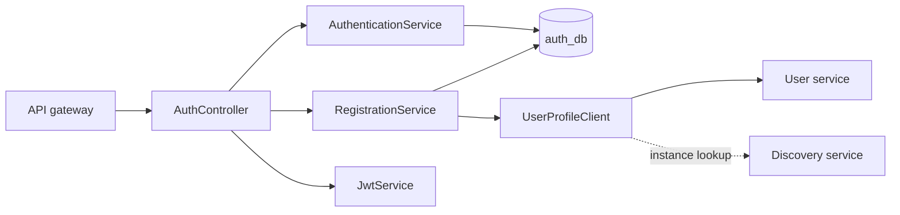
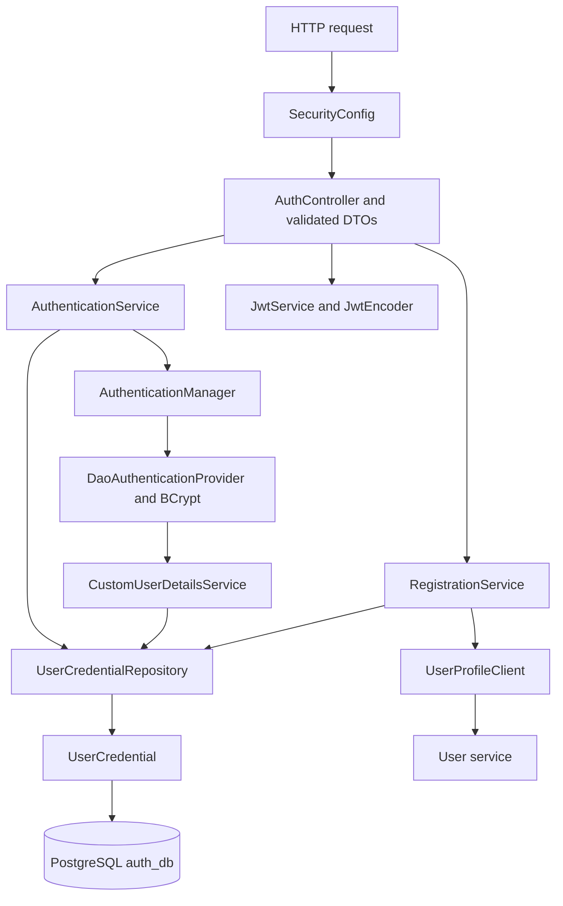
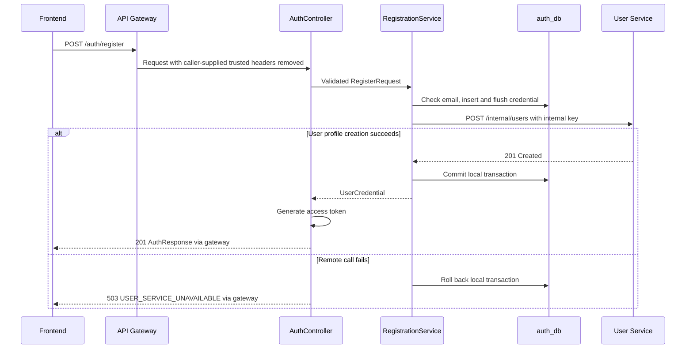
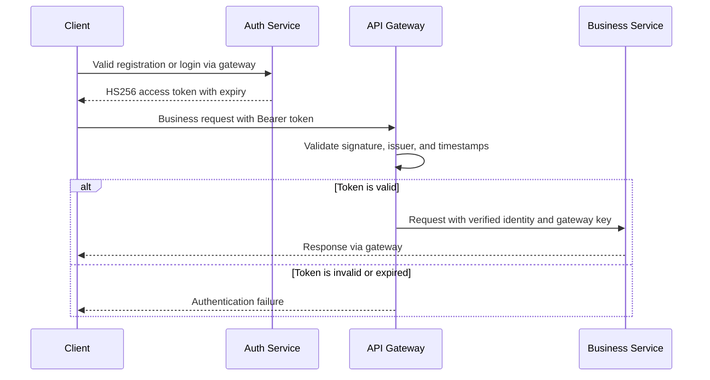
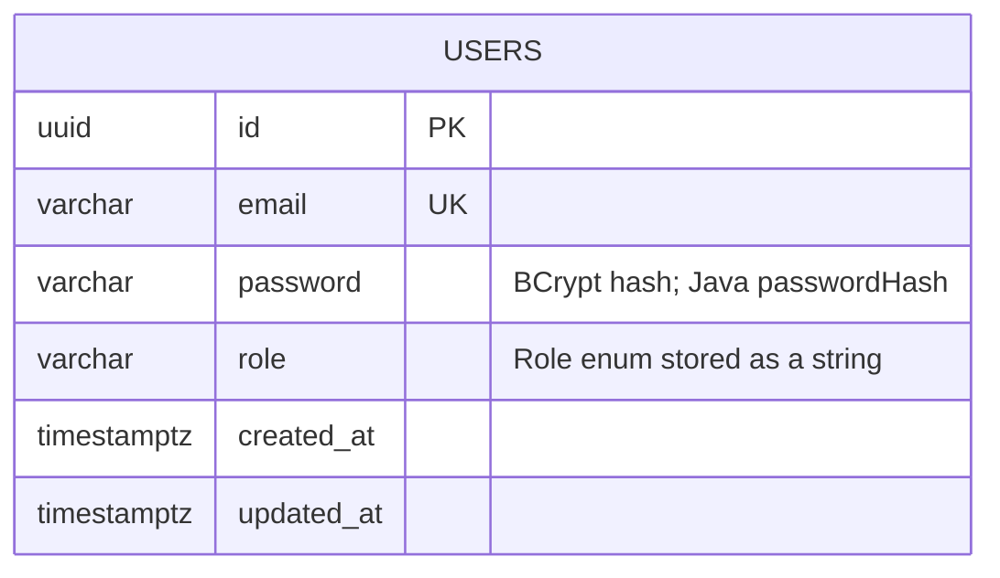
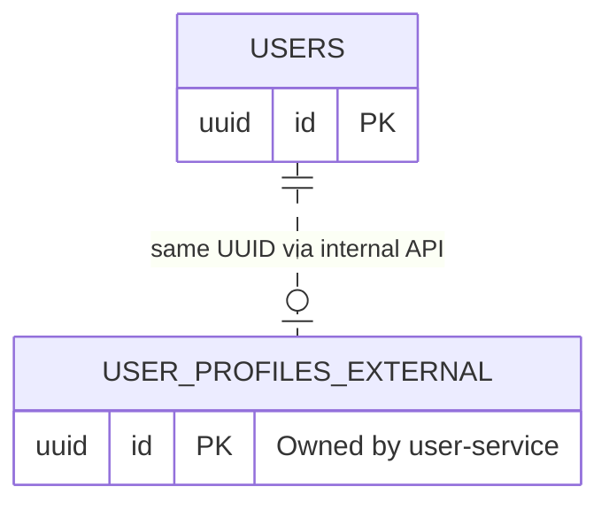

# Auth Service: End-to-End Architecture

This document traces the current implementation from its HTTP boundary through
authorization, service behavior, data relationships, and runtime dependencies.
The numbered structure follows [Job Service: End-to-End Architecture](../../docs/development/job-service-architecture.md).

## 1. Responsibility

`auth-service` owns account credentials, registration, password authentication, and access-token
issuance. Personal and professional profiles belong to [user-service](../user-service/architecture.md).

The service uses Java 21, Spring Boot 4, Spring MVC, Spring Security, Spring Data JPA, Flyway,
PostgreSQL, and the Eureka client. Its default port is `8081`, its registry name is `auth-service`,
and its database is `auth_db`. Exact dependency versions are in [pom.xml](pom.xml).

## 2. System Context



The gateway forwards `/auth/**` without requiring a token. Registration makes a synchronous
internal call to user-service; login uses only locally owned credentials.

## 3. Layered Architecture



Source root: [src/main/java/com/herafi/auth_service](src/main/java/com/herafi/auth_service).

| Package | Responsibility |
| --- | --- |
| `controller` | `AuthController` validates requests and returns authentication responses. |
| `service` | Registration, credential authentication, JWT creation, and the user-service client. |
| `security` | `CustomUserDetailsService` and `UserPrincipal` adapt stored credentials to Spring Security. |
| `config` | Stateless HTTP security, BCrypt, JWT signing, and a load-balanced `RestClient`. |
| `entity`, `repository` | `UserCredential`, `Role`, and `UserCredentialRepository`. |
| `dto`, `exception` | Request/response contracts and centralized validation/domain error handling. |

### HTTP and DTO layer

`AuthController` applies Bean Validation and chooses response status. `RegisterRequest` carries
email, password, and names; `LoginRequest` carries credentials. `CreateUserProfileRequest` is the
internal profile-creation contract. `AuthResponse` exposes a token and user summary, never the
password hash.

### Service and persistence layer

Registration owns normalization and credential creation. Authentication delegates password checks
to Spring Security. `JwtService` owns token claims and signing. `UserCredentialRepository` is the
only database boundary. The profile client owns the remote HTTP call and failure translation.

## 4. Public API

| Method | Path | Behavior |
| --- | --- | --- |
| `POST` | `/auth/register` | Create credentials and a user profile; return `201` with an access token. |
| `POST` | `/auth/login` | Authenticate an existing account; return an access token. |
| `GET` | `/actuator/health` | Service health. |

Registration, login, health, `/swagger-ui/**`, and `/v3/api-docs/**` are permitted without
authentication. Other requests are denied by `SecurityConfig`. Sessions, form login, HTTP Basic,
and CSRF protection are disabled for this API.


There are no `/internal/**` controllers in this service. Its internal integration is an outbound
call to user-service, authenticated with `X-Internal-Api-Key`.

## 5. Account Registration

Example request to `POST /auth/register`:

```json
{
  "email": "amina@example.com",
  "password": "example-password",
  "firstName": "Amina",
  "lastName": "El Amrani"
}
```

1. Validate the request and normalize the email with trimming and lowercase conversion.
2. Reject an existing email, generate a UUID, hash the password with BCrypt, and assign `USER`.
3. Save and flush the credential inside a local database transaction.
4. Call `POST /internal/users` with the same UUID and normalized email, plus trimmed names.
   `UserProfileClient` sends `X-Internal-Api-Key`; its `http://USER-SERVICE` base URL is resolved
   through Eureka and Spring Cloud LoadBalancer.
5. Commit the credential transaction and return a signed access token.

A user-service HTTP failure becomes `503 USER_SERVICE_UNAVAILABLE` and rolls back the local
credential transaction. The two services have separate transactions: a profile already committed
remotely cannot be rolled back by auth-service. No distributed transaction or compensation is
implemented.



## 6. Authentication and Privacy

`AuthenticationService` normalizes the email and delegates to `AuthenticationManager` backed by
`DaoAuthenticationProvider`, `CustomUserDetailsService`, and BCrypt. After successful authentication,
the stored credential is loaded and `JwtService` issues a token. Login does not call user-service.

Passwords are BCrypt hashes in `users.password`. The Java property is `passwordHash`.
Names are forwarded to user-service rather than stored with credentials. Both registration and
login normalize email with trim and lowercase conversion. Login failures use the same invalid
credentials response rather than returning password-check details.

## 7. Token Lifecycle and Security Rules

`AuthResponse` contains `accessToken`, `tokenType` (`Bearer`), `expiresIn` in seconds, and a user
summary. Tokens use HS256 with a secret of at least 32 UTF-8 bytes. Claims include the credential
UUID as `sub`, `email`, `role`, issuer, issue/expiry times, and a random token ID. The default token
lifetime is 15 minutes. The [gateway](../api-gateway/architecture.md) verifies these tokens using
the same secret and issuer. There is no refresh-token or revocation endpoint in the current code.



`USER` is assigned on registration. Professional onboarding does not change this credential role;
worker eligibility is a user-service profile decision.

## 8. User Profile Integration

`UserServiceClientConfig` supplies a load-balanced `RestClient` with base URL
`http://USER-SERVICE`. Eureka supplies the destination instance. `UserProfileClient` sends the
account UUID, normalized email, and trimmed names to `POST /internal/users`.

The call happens within the local registration transaction. Remote success and local commit are
separate outcomes; a lost response or local commit failure can leave a remote profile without a
committed credential. No retry, compensation, or explicit per-client HTTP timeout is configured
in this client. `RestClientException` is translated to `UserServiceUnavailableException`.

## 9. Persistence Model

### Locally owned entity

`UserCredential` maps to `users`. This service has one JPA entity and no local entity-to-entity
association. `PK` identifies a primary key and `UK` a unique column.



### Relationship across services

The following is a logical UUID association, not a database foreign key. `USER_PROFILES_EXTERNAL`
belongs to `user_db`. Successful registration is intended to produce one profile for one account;
the optional profile below allows for partial registration outcomes.



[V1__create_users.sql](src/main/resources/db/migration/V1__create_users.sql) creates `users` with a
UUID primary key, unique email, password hash in the `password` column, role, and creation/update
timestamps. JPA validates the schema (`ddl-auto=validate`) and open-in-view is disabled.

The account UUID is shared with user-service by API contract. There is no foreign key across the
two databases, and this service does not store names or professional-profile data.

| Migration | Change |
| --- | --- |
| `V1__create_users.sql` | Credential table, unique email, role, and audit timestamps. |

## 10. Error Boundary

`GlobalExceptionHandler` produces the auth `ApiErrorResponse` envelope:

```json
{
  "success": false,
  "error": {
    "code": "INVALID_CREDENTIALS",
    "message": "Invalid email or password",
    "errors": []
  }
}
```

| Condition | HTTP | Code |
| --- | ---: | --- |
| Invalid request fields | 400 | `VALIDATION_ERROR` |
| Invalid login credentials | 401 | `INVALID_CREDENTIALS` |
| Duplicate email / caught integrity violation | 409 | `EMAIL_ALREADY_IN_USE` |
| Profile-service HTTP failure | 503 | `USER_SERVICE_UNAVAILABLE` |

Spring Security handles requests denied before the controller separately. Clients should use
the error code rather than depend on the human-readable message.

## 11. Configuration and Local Runtime

Configuration source: [application.properties](src/main/resources/application.properties).

| Environment variable | Purpose / default |
| --- | --- |
| `SERVER_PORT` | HTTP port; `8081`. |
| `DB_URL` | JDBC URL; `jdbc:postgresql://localhost:5432/auth_db`. |
| `DB_USERNAME`, `DB_PASSWORD` | Required database credentials. |
| `JWT_SECRET` | Required signing secret, shared with the gateway. |
| `JWT_ISSUER` | Token issuer; `7irafi-auth-service`. |
| `JWT_ACCESS_TOKEN_TTL` | Access-token lifetime; `15m`. |
| `INTERNAL_API_KEY` | Required key for user-service calls. |
| `DISCOVERY_SERVICE_URL` | Eureka endpoint; `http://localhost:8761/eureka/`. |
| `SHOW_SQL` | SQL logging; `true`. |

Run `./mvnw spring-boot:run` from this directory after providing configuration and starting
PostgreSQL and discovery-service. Successful registration additionally requires user-service to
be available in Eureka. The repository [Compose file](../../infra/docker/docker-compose.yml)
provides the development wiring; its credentials are development defaults.

Run `./mvnw test` for the existing context-load test. Test configuration is under
`src/test/resources` and `src/main/resources/application-test.properties`; the latter requires
the `test` profile to be activated when used.

## 12. Developer Change Guide

1. Change request validation in DTOs and response/status handling in `AuthController`.
2. Keep email normalization and credential creation in `RegistrationService`.
3. Keep password verification in the Spring Security provider; never compare raw hashes in controllers.
4. Coordinate token claim, issuer, or signing changes with api-gateway.
5. Coordinate profile-creation contract changes with user-service.
6. Add a Flyway migration for schema changes and preserve applied migrations.

Existing coverage is a context-load test. Use `./mvnw test`; use the `test` profile when
relying on the H2 configuration. New authentication or transaction behavior needs focused tests.

## 13. Open Decisions and Risks

- Registration spans two databases without atomic commit or compensation.
- Duplicate-profile reconciliation after a partial registration is not implemented.
- User-profile client timeouts and retries are not explicitly configured.
- Access tokens have a fixed lifetime; refresh tokens and server-side revocation are absent.
- Auth-service and gateway must keep their signing secret and issuer consistent.

## 14. Source Map

Java source root: [src/main/java/com/herafi/auth_service](src/main/java/com/herafi/auth_service).

| Concern | Primary files |
| --- | --- |
| HTTP API | [controller/AuthController.java](src/main/java/com/herafi/auth_service/controller/AuthController.java) |
| Registration | [service/RegistrationService.java](src/main/java/com/herafi/auth_service/service/RegistrationService.java) |
| Login | [service/AuthenticationService.java](src/main/java/com/herafi/auth_service/service/AuthenticationService.java), [security/CustomUserDetailsService.java](src/main/java/com/herafi/auth_service/security/CustomUserDetailsService.java) |
| JWT issuance | [service/JwtService.java](src/main/java/com/herafi/auth_service/service/JwtService.java), [config/JwtConfig.java](src/main/java/com/herafi/auth_service/config/JwtConfig.java) |
| Password security | [config/PasswordConfig.java](src/main/java/com/herafi/auth_service/config/PasswordConfig.java), [config/SecurityConfig.java](src/main/java/com/herafi/auth_service/config/SecurityConfig.java) |
| Profile integration | [service/UserProfileClient.java](src/main/java/com/herafi/auth_service/service/UserProfileClient.java), [config/UserServiceClientConfig.java](src/main/java/com/herafi/auth_service/config/UserServiceClientConfig.java) |
| Persistence | [entity/UserCredential.java](src/main/java/com/herafi/auth_service/entity/UserCredential.java), [repository/UserCredentialRepository.java](src/main/java/com/herafi/auth_service/repository/UserCredentialRepository.java) |
| Error mapping | [exception/GlobalExceptionHandler.java](src/main/java/com/herafi/auth_service/exception/GlobalExceptionHandler.java) |

Runtime properties: [application.properties](src/main/resources/application.properties).
