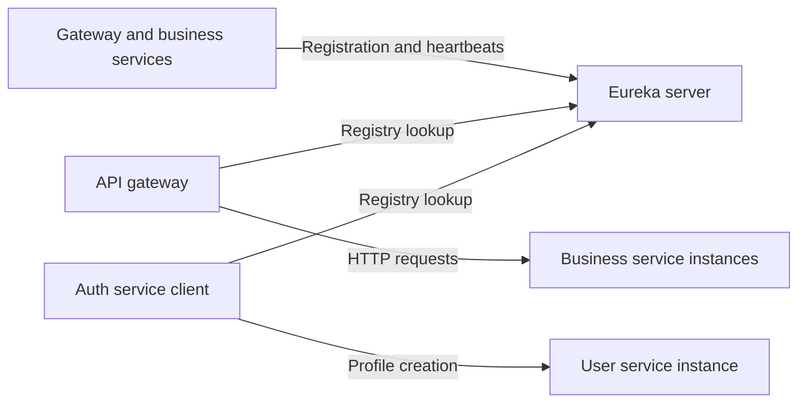
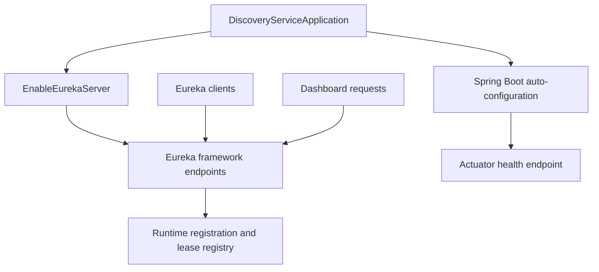
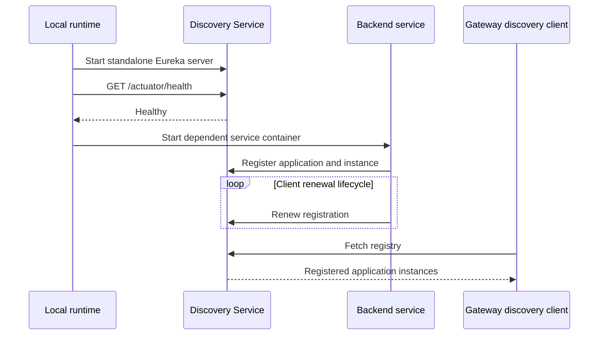
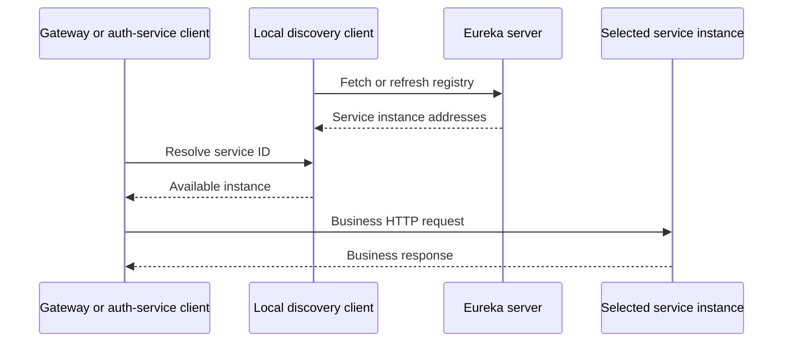
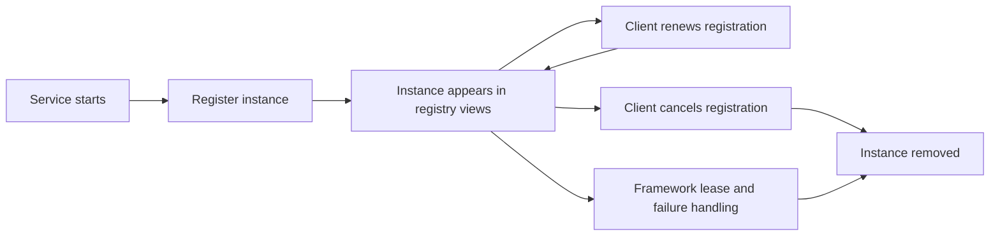
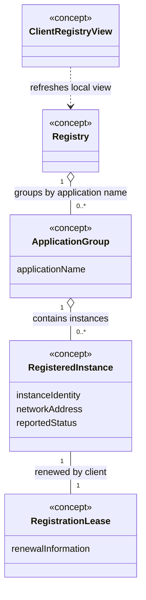

# Discovery Service: End-to-End Architecture

This document traces the current implementation from its HTTP boundary through
authorization, service behavior, data relationships, and runtime dependencies.
The numbered structure follows [Job Service: End-to-End Architecture](../../docs/development/job-service-architecture.md).

## 1. Responsibility

`discovery-service` hosts the Eureka registry used to locate running backend service instances.
It owns service-registration metadata rather than application business data.

The service uses Java 21, Spring Boot 4, Spring Cloud Netflix Eureka Server, and Actuator. Its
default port is `8761` and its application name is `discovery-service`. It has no application
database, repositories, migrations, or custom business controllers.

## 2. System Context

## 3. Layered Architecture

The application contains a single main class. Eureka supplies registration, renewal, registry
lookup, and dashboard handling. There are no custom controller, DTO, service, repository, or JPA
layers. The normal business-service layering ends at framework configuration for this service.

The application entry point is
[DiscoveryServiceApplication.java](src/main/java/com/herafi/discovery_service/DiscoveryServiceApplication.java).
`@SpringBootApplication` starts Spring Boot and `@EnableEurekaServer` enables the registry and its
framework-provided endpoints.

[application.properties](src/main/resources/application.properties) configures a standalone server:

| Property | Current setting |
| --- | --- |
| `server.port` | `${SERVER_PORT:8761}`. |
| `eureka.client.register-with-eureka` | `false`: this server does not register itself. |
| `eureka.client.fetch-registry` | `false`: this server does not fetch another server's registry. |
| `management.endpoints.web.exposure.include` | `health`. |

No peer replication topology, persistent registry store, or application-level authentication is
configured. Registrations are runtime state and are repopulated by clients after a server restart.

## 4. Public API

The framework supplies these interfaces:

| Path | Consumer | Purpose |
| --- | --- | --- |
| `/` | Developer/operator browser | Eureka dashboard. |
| `/eureka/` | Eureka clients | Base path for registration, renewal, cancellation, and registry queries. |
| `/actuator/health` | Compose and monitoring | Discovery server health. |

There are no application-authored REST controllers or public business APIs. Client protocol
details are provided by the Eureka dependency configured in [pom.xml](pom.xml). No custom Spring
Security filter or gateway/internal API-key check is configured for these framework endpoints.

## 5. Service Registration

At startup, each configured Eureka client advertises its application name and instance address.
The framework maintains registration and lease metadata and clients renew their registrations.
The discovery server itself sets both `register-with-eureka` and `fetch-registry` to `false`.

Registration data belongs to the runtime framework and is not inserted into PostgreSQL. Registry
membership is eventually reflected in client caches; it is separate from a direct HTTP health probe.

## 6. Registry Lookup and Request Routing

All five other backend services enable Eureka registration and registry fetching. Their
`DISCOVERY_SERVICE_URL` defaults to `http://localhost:8761/eureka/`; Compose sets it to
`http://discovery-service:8761/eureka/`.

| Registered application | Default service port | Use of discovery in the current code |
| --- | --- | --- |
| `api-gateway` | `8080` | Resolve routes and enumerate instances for `/status`. |
| `auth-service` | `8081` | Resolve the `USER-SERVICE` client for registration. |
| `user-service` | `8082` | Advertise its instance to callers. |
| `job-service` | `8083` | Advertise its instance to the gateway. |
| `application-service` | `8084` | Advertise its instance to the gateway. |

Although application-service registers with Eureka, its outbound job/user clients use configured
`JOB_SERVICE_URL` and `USER_SERVICE_URL` addresses directly. Registry registration does not make
those clients load balanced.

Business payloads travel directly to the chosen service. The registry is not an HTTP proxy and
does not validate JWTs or authorize business operations.

## 7. Registration Lifecycle and Availability

The runtime relationship is a named application with a set of live instance registrations.
Clients register and renew; cancellation or framework lease handling can remove registrations.
The exact timing and framework failure policies are not overridden in this application.

This diagram describes the conceptual lifecycle, not an application-owned enum. Registry updates
and cached client views do not provide an immediate or atomic view of process availability.
No custom retry, failover, lease timing, or peer topology is defined in this service.

## 8. Health and Deployment Integration

Compose waits for discovery-service's `/actuator/health` before starting dependent backend
containers. This checks server health; it does not assert that every business service is registered.
The dashboard exposes the registry view. The gateway's `/status` independently discovers services
and probes their `/actuator/health` endpoints.

The current Compose deployment has one Eureka server. It publishes port `8761` and sets clients'
`DISCOVERY_SERVICE_URL` to `http://discovery-service:8761/eureka/`. Host-run clients default to
`http://localhost:8761/eureka/`.

Because the server does not register itself, the gateway's registry-driven status listing is not
an inventory of the discovery server itself. Its health endpoint is monitored separately by Compose.

## 9. Persistence Model and Registry Relationships

There are no application JPA entities, database tables, foreign keys, or Flyway migrations.
The following Mermaid model describes framework runtime concepts, not Java classes authored in
this repository or a proposed SQL schema.

One application name can have multiple registered instances. Each instance has registration/lease
metadata. Clients maintain local registry views used by load balancing. These associations have
no SQL key constraints and their names above are descriptive concepts, not additional entities
to implement.

No persistent registry store is configured. Following a server restart, clients repopulate the
runtime registry. Business databases remain owned by their services and are unaffected by this
registry model.

## 10. Error Boundary

Discovery-service defines no domain exception handler or custom API error envelope. Eureka
handles its own protocol responses, and Actuator handles health responses.

| Failure | Architectural effect |
| --- | --- |
| Discovery server unreachable | Client registration and registry refresh cannot reach this server. |
| Stale client registry view | A caller can attempt to contact an instance whose availability changed. |
| No instance for a service ID | Discovery-based callers cannot select a target from that view. |
| Server restart | Runtime registrations must be repopulated by clients. |

Callers may retain cached instances during an outage. This service does not supply application
fallback responses, proxy failed business requests, or normalize downstream service errors.

## 11. Configuration and Local Runtime

The application entry point is
[DiscoveryServiceApplication.java](src/main/java/com/herafi/discovery_service/DiscoveryServiceApplication.java).
`@SpringBootApplication` starts Spring Boot and `@EnableEurekaServer` enables the registry and its
framework-provided endpoints.

[application.properties](src/main/resources/application.properties) configures a standalone server:

| Property | Current setting |
| --- | --- |
| `server.port` | `${SERVER_PORT:8761}`. |
| `eureka.client.register-with-eureka` | `false`: this server does not register itself. |
| `eureka.client.fetch-registry` | `false`: this server does not fetch another server's registry. |
| `management.endpoints.web.exposure.include` | `health`. |

No peer replication topology, persistent registry store, or application-level authentication is
configured. Registrations are runtime state and are repopulated by clients after a server restart.

Run `./mvnw spring-boot:run` from this directory; no database or credentials are required by the
current application configuration. `SERVER_PORT` overrides the listening port.

The service [Dockerfile](Dockerfile) uses a Java 21 Maven image. The repository
[Compose file](../../infra/docker/docker-compose.yml) publishes port `8761` and checks
`/actuator/health`; the other backend containers depend on discovery becoming healthy.

Run `./mvnw test` for the existing Spring context-load test in
[DiscoveryServiceApplicationTests.java](src/test/java/com/herafi/discovery_service/DiscoveryServiceApplicationTests.java).
Dependency versions are defined in [pom.xml](pom.xml).

## 12. Developer Change Guide

1. Keep discovery-server behavior in framework configuration and the application entry point.
2. Give new services a stable application name and the correct Eureka endpoint.
3. Coordinate service-name changes with gateway routes and discovery-based clients.
4. Treat peer replication or authentication as deployment-wide changes affecting every client.
5. Keep application business data in the owning service, outside the registry.

Run `./mvnw test` for the existing context-load test. For discovery behavior changes, verify
registration and resolution with actual client instances as well as server startup.

## 13. Open Decisions and Risks

- The deployment has one registry server and no configured peer replication.
- Registry and client-cache updates are not instantaneous health information.
- A server restart loses its local runtime view until clients repopulate it.
- No application-level authentication is configured for the dashboard/registry endpoints.
- Adding application-service instances does not change that service's direct outbound job/user URLs.

## 14. Source Map

| Concern | Primary files |
| --- | --- |
| Eureka bootstrap | [DiscoveryServiceApplication.java](src/main/java/com/herafi/discovery_service/DiscoveryServiceApplication.java) |
| Registry/runtime configuration | [application.properties](src/main/resources/application.properties) |
| Framework dependencies | [pom.xml](pom.xml) |
| Container startup | [Dockerfile](Dockerfile) |
| Context test | [DiscoveryServiceApplicationTests.java](src/test/java/com/herafi/discovery_service/DiscoveryServiceApplicationTests.java) |
| Client environment and health dependencies | [docker-compose.yml](../../infra/docker/docker-compose.yml) |

The dashboard, registry handlers, leases, and client protocol implementations are supplied by
the Eureka dependency; they do not have custom source files in this service.
