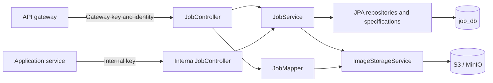
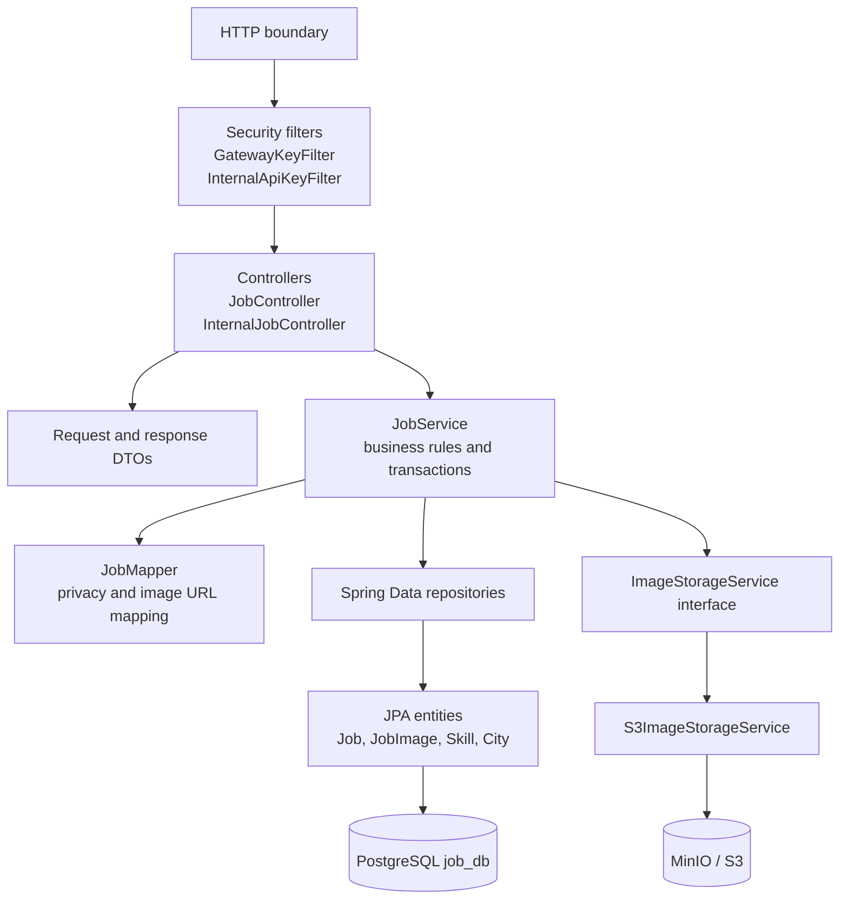
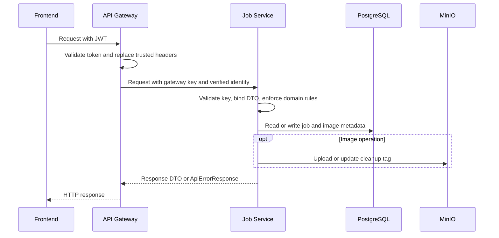
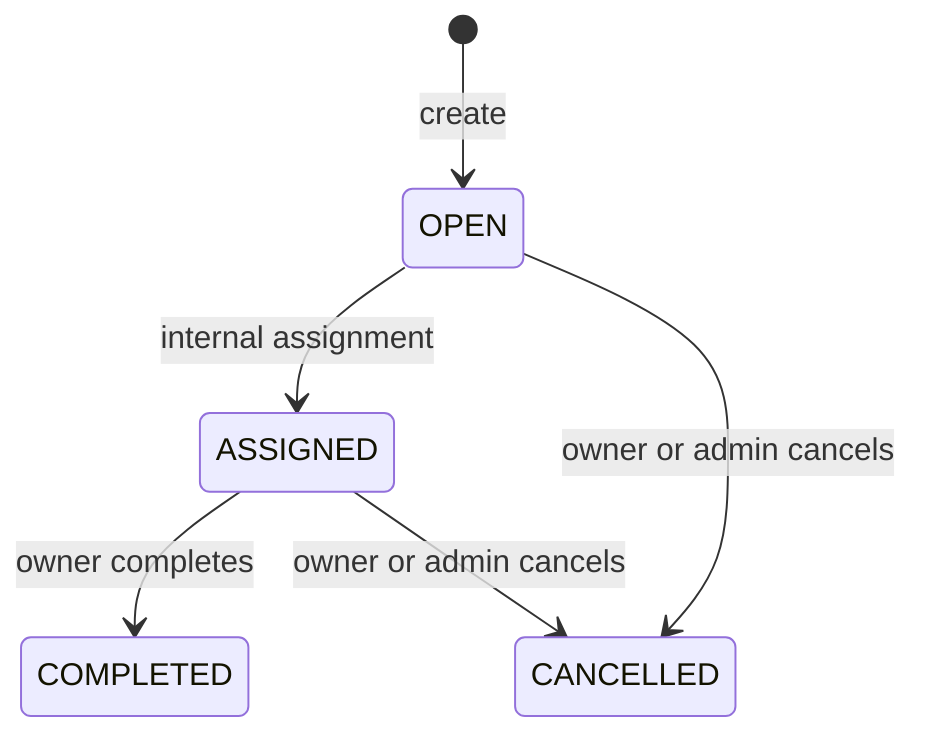
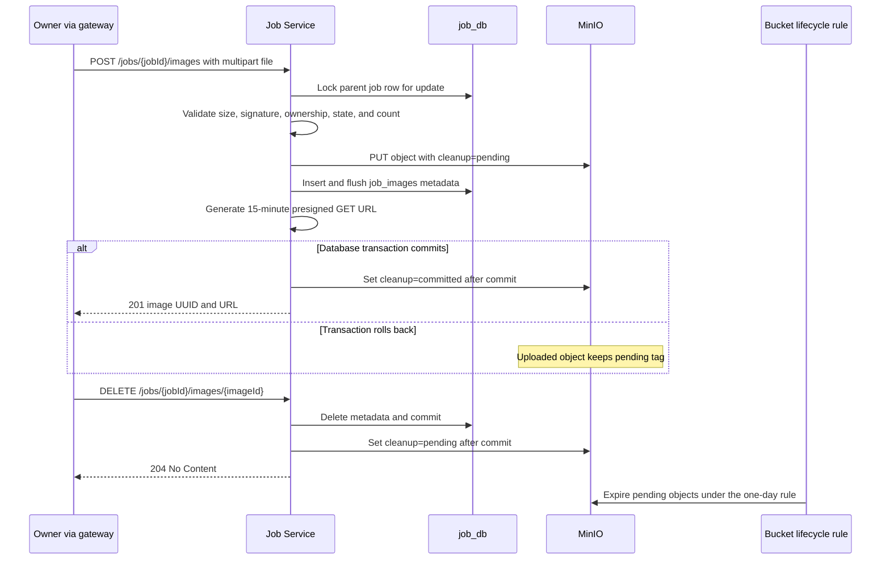
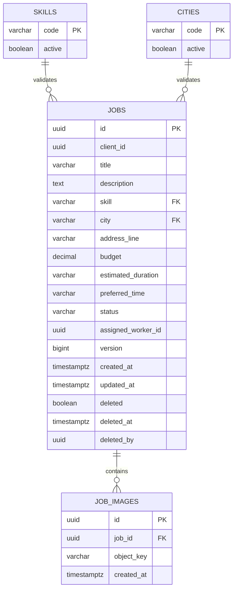
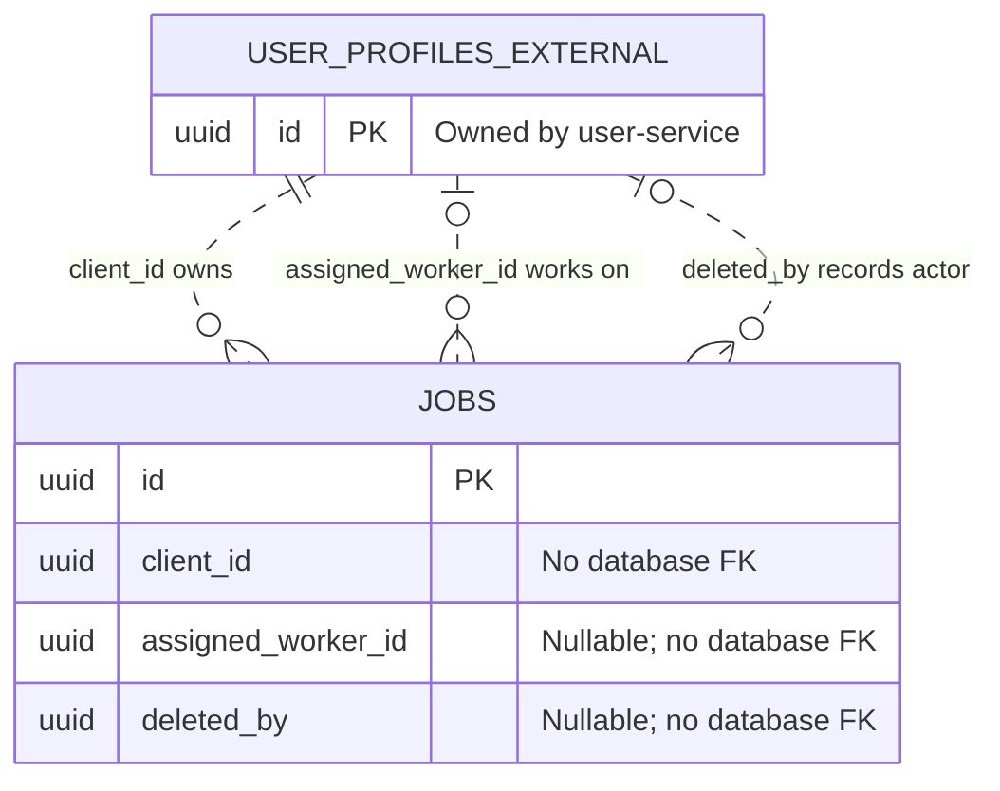

# Job Service: End-to-End Architecture

This document traces the current implementation from its HTTP boundary through
authorization, service behavior, data relationships, and runtime dependencies.
The numbered structure follows [Job Service: End-to-End Architecture](../../docs/development/job-service-architecture.md).

## 1. Responsibility

`job-service` owns job posts, their lifecycle and worker assignment, job search, local skill/city
reference data, and job images. [Application-service](../application-service/architecture.md)
owns applications and requests assignment through the internal job API.

The service uses Java 21, Spring Boot 4, Spring MVC, Bean Validation, Spring Data JPA, Flyway,
PostgreSQL, Eureka, and the AWS S3 SDK. It defaults to port `8083`, registers as `job-service`,
and uses `job_db`. MinIO provides S3-compatible storage in development.

The service stores owner and assigned-worker UUIDs. It does not store credentials, professional
profiles, applications, reviews, or chat messages. Its local reference tables validate job fields.

## 2. System Context



The gateway validates JWTs and supplies trusted identity headers. Application-service calls
internal summary/assignment APIs directly with its internal key. Eureka advertises this service
as `job-service`; MinIO holds image bytes and PostgreSQL holds metadata.

## 3. Layered Architecture



Source root: [src/main/java/com/herafi/job_service](src/main/java/com/herafi/job_service).

| Package | Responsibility |
| --- | --- |
| `controller` | Public job/image operations and internal summary/assignment endpoints. |
| `service` | `JobService` domain rules and `S3ImageStorageService` object storage. |
| `repository`, `entity` | Jobs, images, skills, cities, locking, and thumbnail queries. |
| `specification` | Compose job search predicates through JPA specifications. |
| `mapper`, `dto` | Response projections, address visibility, signed URLs, and validated inputs. |
| `config` | Gateway/internal key filters, S3 clients, image limits, and filter error responses. |
| `exceptions` | Domain failures and centralized HTTP error mapping. |

### HTTP and DTO layer

`GatewayKeyFilter` and `InternalApiKeyFilter` validate the service hop before controllers bind
headers, path/query parameters, validated JSON, or multipart data. Health endpoints are outside
these path filters. `JobController` serves `/jobs`; `InternalJobController` serves internal calls.

| DTO | Purpose |
| --- | --- |
| `CreateJobRequest`, `UpdateJobRequest` | Validated creation and editable fields. |
| `JobFilter`, `AssignWorkerRequest` | Search inputs and internal assignment body. |
| `JobResponse` | Mutation and owner-list response, including address. |
| `JobListResponse` | Search projection without address, with an optional thumbnail URL. |
| `JobDetailResponse` | Detail projection with conditional address and image URLs. |
| `JobSummaryResponse` | Internal ID, owner, status, and assigned-worker projection. |
| `JobImageResponse`, `PageResponse` | Image result and pagination metadata. |

### Service and repository layer

`JobService` owns authorization, reference checks, lifecycle rules, and image orchestration.
State/image mutations use service transactions; creation uses repository `save`. Repositories
implement Spring Data JPA; job search adds `JpaSpecificationExecutor` and `JobSpecification`.
`JobMapper` creates response projections and controls detail-address visibility.

### Storage layer

`ImageStorageService` exposes `upload`, `generateDownloadUrl`, `markCommitted`, and
`markPendingCleanup`. `S3ImageStorageService` implements them using the AWS SDK. Object expiry
is delegated to a bucket lifecycle rule; the current interface has no direct delete operation.
The S3 client uses the internal endpoint and the presigner uses the browser-facing endpoint.

## 4. Public API

`GatewayKeyFilter` protects `/jobs` and `/jobs/**` using `X-Gateway-Key`.
`InternalApiKeyFilter` protects `/internal` and `/internal/**` using `X-Internal-Api-Key`.
Public requests are authenticated at the gateway; this service trusts its injected `X-User-Id`
and `X-User-Role` after key validation. It does not decode JWTs.

| Method | Path | Behavior |
| --- | --- | --- |
| `POST` | `/jobs` | Create an `OPEN` job owned by the caller; return `201`. |
| `GET` | `/jobs` | Filtered, sorted, paginated job list with thumbnail URLs. |
| `GET` | `/jobs/my` | List the caller's nondeleted jobs. |
| `GET` | `/jobs/{id}` | Read details and images; expose address only to owner/assigned worker. |
| `PUT` | `/jobs/{id}` | Owner updates title, description, and address while the job is open. |
| `PATCH` | `/jobs/{id}/complete` | Owner completes an assigned job. |
| `PATCH` | `/jobs/{id}/cancel` | Owner/admin cancels an open or assigned job. |
| `DELETE` | `/jobs/{id}` | Owner/admin soft-deletes a job unless it is assigned; return `204`. |
| `GET` | `/jobs/skills`, `/jobs/cities` | List active reference codes. |
| `POST` | `/jobs/{jobId}/images` | Owner uploads multipart `file` to an open job; return `201`. |
| `DELETE` | `/jobs/{jobId}/images/{imageId}` | Owner removes an image; return `204`. |
| `GET` | `/internal/jobs/{id}/summary` | Return job ID, owner, status, and assigned worker. |
| `PATCH` | `/internal/jobs/{id}/assign` | Assign the supplied `workerId` to an open job. |
| `GET` | `/actuator/health` | Service health. |

Search accepts skill, city, status, minimum/maximum budget, duration, and preferred-time filters.
It always excludes deleted jobs. Sort fields are restricted to `createdAt`, `budget`, and `title`;
the default is `createdAt,desc`. Page size defaults to 20 and is capped at 20.



## 5. Job Creation

`POST /jobs` accepts:

```json
{
  "title": "Fix kitchen sink",
  "description": "The sink is leaking.",
  "skill": "PLUMBING",
  "city": "CASABLANCA",
  "addressLine": "123 Main Street",
  "budget": 300.00,
  "estimatedDuration": "HALF_DAY",
  "preferredTime": "MORNING"
}
```

The service performs this sequence:

1. Validate that `skill` is present and active in `skills`.
2. Validate that `city` is present and active in `cities`.
3. Copy user-editable fields from the request.
4. Copy `X-User-Id` into `clientId`.
5. Apply defaults: `OPEN` status and `ANYTIME` preferred time.
6. Let JPA assign UUID and timestamps through entity callbacks.
7. Save the job.

The request cannot control `id`, `clientId`, `status`, `assignedWorkerId`,
`version`, `deleted`, or timestamps.

## 6. Search and Privacy

`GET /jobs` composes optional skill, city, status, minimum/maximum budget, duration, and
preferred-time predicates. It always excludes soft-deleted rows. Allowed sort fields are
`createdAt`, `budget`, and `title`; the default is `createdAt,desc`. Page size is capped at 20.

Search returns `JobListResponse` without `addressLine`, with an optional thumbnail URL. A batch
query selects the earliest image by `(createdAt, id)` for each returned job. Thumbnail-signing
failures are logged and can leave that thumbnail absent without failing the entire list.

`JobResponse` serves mutations and the owner's jobs list and includes the address. Detail reads
use `JobDetailResponse`; `JobMapper` includes the address only for the job owner or assigned
worker. Detail images are explicitly loaded in deterministic `(createdAt, id)` order inside the
read transaction. Signed URLs last 15 minutes and are generated from stored object keys.

## 7. Lifecycle and State Rules



Assignment sets `assignedWorkerId`; cancellation clears it. Repeating assignment to the same
worker while already assigned returns the current summary. The internal assignment endpoint
trusts its caller to validate the applicant and job owner; application-service performs that
orchestration. Job-service makes no outbound call to user-service for eligibility.

`Job.version` uses JPA optimistic locking for concurrent mutations; conflicts map to HTTP `409`.
Image uploads additionally take a pessimistic write lock on the job before enforcing image count.
Soft deletion records `deleted`, `deletedAt`, and `deletedBy` separately from lifecycle status.
Nondeleted lookups hide soft-deleted jobs, including from internal summaries.

The `deleted` flag is separate from `JobStatus`: deletion can hide open, completed, or cancelled
jobs, but assigned jobs must first leave the assigned state. There is no reopen operation.
Updating a job changes only title, description, and address. Image removal checks ownership and
job existence without requiring `OPEN`, whereas image upload requires an open job.

The internal API contains summary and assignment endpoints only. Chat context is obtained from
application-service's `/internal/applications/{applicationId}/chat-context`; this service has no
`/internal/jobs/{id}/chat-eligibility` controller.

## 8. Image Lifecycle



Uploads accept JPEG, PNG, or WebP magic bytes, not arbitrary claimed MIME types. Default limits
are 10 MB per file and 10 images per job. A pessimistic parent lock serializes concurrent upload
count checks. Keys use `jobs/{jobId}/{imageId}`, and PostgreSQL stores those keys rather than URLs.

New objects start as pending so failed metadata transactions leave objects eligible for storage
expiry. Successful metadata commit changes the tag to committed. Deleting an image removes its
metadata then marks the object pending; soft-deleting a job retains its metadata and marks its
objects pending after commit. Cancellation retains images.

Compose creates the bucket and a lifecycle rule for `cleanup=pending` with one-day expiry.
There is no scheduled Java reaper or durable retry table. Tag-update failures are logged, so
metadata and storage changes are not one atomic transaction. A failed committed-tag update can
leave a valid upload eligible for expiry; a failed pending-tag update can retain an unused object.

## 9. Persistence Model



`PK` means primary key and `FK` means a database foreign key. Each job has one skill and one city;
each reference code can be used by many jobs. One job can have zero or more images, and each image
belongs to one job. The final schema has no image position or cleanup-queue table.

| Entity relationship | Implementation |
| --- | --- |
| `Job` to `JobImage` | `@OneToMany(mappedBy = "job")`, cascade ALL and orphan removal; image has the owning `@ManyToOne`. |
| `Job` to skill/city | Java string codes with SQL foreign keys to `skills.code` and `cities.code`. |
| Owner / assigned worker / deleting user | UUID fields referencing identities across services; no local user foreign keys. |

`JobStatus`, `EstimatedDuration`, and `PreferredTime` are string enums, not additional tables.
The following external associations are logical API references only:



Flyway migrations live in [src/main/resources/db/migration](src/main/resources/db/migration).

| Migration | Change |
| --- | --- |
| `V1__init_jobs.sql` | Jobs, skills, cities, foreign keys, indexes, and state constraints. |
| `V2__seed_job_reference_data.sql` | Initial skills and cities. |
| `V3__add_soft_delete.sql` | Soft-delete fields on jobs. |
| `V4__create_job_images.sql` | Image metadata table with its original position field. |
| `V5__add_job_version.sql` | Optimistic-lock version column. |
| `V6__remove_job_image_position.sql` | Remove image position and add creation-time index. |
| `V7__index_job_images_by_creation_and_id.sql` | Deterministic image-order index. |
| `V8__create_job_image_cleanup.sql` | Historical cleanup queue creation. |
| `V9__remove_job_image_cleanup.sql` | Remove cleanup queue; current cleanup uses object tags. |

Hibernate validates the schema and open-in-view is disabled. SQL checks constrain positive budget,
enum strings, and the assignment/status relationship: assigned/completed jobs require a worker;
open/cancelled jobs require no worker. Reference catalogs are locally owned and independently
seeded from user-service's catalogs.

## 10. Error Boundary

The `GlobalExceptionHandler` and security filters expose a common
`ApiErrorResponse` shape:

```json
{
  "timestamp": "2026-09-04T12:00:00Z",
  "status": 409,
  "code": "JOB_STATE_CONFLICT",
  "message": "Only open or assigned jobs can be cancelled",
  "path": "/jobs/<id>/cancel"
}
```

Validation errors may also contain `fieldErrors`.

| Condition | HTTP | Code |
| --- | ---: | --- |
| Invalid DTO fields | 400 | `VALIDATION_ERROR` |
| Malformed body or UUID | 400 | `INVALID_REQUEST` |
| Invalid page parameters | 400 | `INVALID_PAGINATION` |
| Invalid sort field/direction | 400 | `INVALID_SORT` |
| Unknown or inactive skill/city | 400 | `INVALID_REFERENCE` |
| Empty, invalid, or oversized image | 400 / 413 | `INVALID_IMAGE` |
| Missing image multipart part | 400 | `INVALID_IMAGE` |
| Missing or invalid gateway/internal key | 401 | `UNAUTHORIZED` |
| Access denied | 403 | `JOB_ACCESS_DENIED` |
| Missing active job or image | 404 | `JOB_NOT_FOUND` |
| Invalid lifecycle state | 409 | `JOB_STATE_CONFLICT` or `JOB_NOT_OPEN` |
| Optimistic-lock conflict | 409 | `CONCURRENT_MODIFICATION` |
| Unexpected failure | 500 | `INTERNAL_ERROR` |

The response code is the client contract. The legacy access/state codes remain
canonical for compatibility: `JOB_ACCESS_DENIED` and `JOB_STATE_CONFLICT`.
`JOB_NOT_OPEN` is reserved for assignment attempts on non-open jobs, and
`CONCURRENT_MODIFICATION` is reserved for optimistic-lock conflicts. Clients
should not branch on the human-readable message.

## 11. Configuration and Local Runtime

Configuration source: [application.properties](src/main/resources/application.properties).

| Environment variable / property | Purpose / default |
| --- | --- |
| `SERVER_PORT` | HTTP port; `8083`. |
| `DB_URL` | JDBC URL; `jdbc:postgresql://localhost:5432/job_db`. |
| `DB_USERNAME`, `DB_PASSWORD` | Database credentials; development defaults are supplied. |
| `GATEWAY_SHARED_SECRET`, `INTERNAL_API_KEY` | Gateway and internal caller keys; development defaults are supplied. |
| `DISCOVERY_SERVICE_URL` | Eureka endpoint; `http://localhost:8761/eureka/`. |
| `S3_ENDPOINT` | Storage API endpoint; `http://minio:9000`. |
| `S3_PUBLIC_ENDPOINT` | Browser-reachable endpoint used for signatures; `http://localhost:9000`. |
| `S3_ACCESS_KEY`, `S3_SECRET_KEY` | Storage credentials; development defaults are supplied. |
| `S3_REGION`, `S3_BUCKET` | `us-east-1` and `jobs`. |
| `jobs.images.max-file-size`, `jobs.images.max-count` | `10MB` and `10`; multipart request limit is `12MB`. |

Run `mvn spring-boot:run` with PostgreSQL, discovery, and a configured storage bucket/lifecycle
rule. For a host-run service, set `S3_ENDPOINT` to a reachable address. The
[Compose file](../../infra/docker/docker-compose.yml) provisions the development bucket, publishes
port `8083`, mounts source, and runs this service with Maven.

There are currently no checked-in Java tests for this service. `mvn test` runs the Maven test
phase but does not provide job-domain regression coverage. Dependencies are in [pom.xml](pom.xml).

## 12. Developer Change Guide

Use these ownership rules when changing behavior:

1. Add or change an HTTP contract in a DTO and controller.
2. Put authorization, state, and consistency rules in `JobService`.
3. Add database access to a repository only when an existing query cannot express
   the requirement.
4. Change schema through a new Flyway migration; never edit an applied migration.
5. Keep image provider details behind `ImageStorageService`.
6. Keep privacy decisions in `JobMapper` or a dedicated response-mapping layer,
   not in frontend code.
7. Use fresh presigned URLs for returned image metadata; never persist a URL.
8. Preserve the distinction between public `/jobs/**` and internal
   `/internal/**` routes.

There are currently no checked-in Java tests for this service. `mvn test` executes the Maven
test phase without domain coverage. Changes to owner checks, state transitions, optimistic
locking, image limits, or cleanup behavior need tests covering the corresponding outcomes.

## 13. Open Decisions and Risks

- Database commits and S3 tag changes are separate operations without a durable retry mechanism.
- The bucket lifecycle rule must exist for pending objects to expire; expiry is not immediate deletion.
- Failed tag updates can either retain unused objects or expire images whose metadata committed.
- Image validation checks magic bytes without full image decoding or dimension limits.
- Internal assignment trusts application-service to verify ownership and worker eligibility.
- User-service and job-service maintain separate reference catalogs with no synchronization.
- Estimated duration is limited to `HALF_DAY`, `FULL_DAY`, and `MULTI_DAY`; coordinates are not stored.

## 14. Source Map

Java source root: [src/main/java/com/herafi/job_service](src/main/java/com/herafi/job_service).

| Concern | Primary files |
| --- | --- |
| Public endpoints | [controller/JobController.java](src/main/java/com/herafi/job_service/controller/JobController.java) |
| Internal endpoints | [controller/InternalJobController.java](src/main/java/com/herafi/job_service/controller/InternalJobController.java) |
| Business rules | [service/JobService.java](src/main/java/com/herafi/job_service/service/JobService.java) |
| Storage | [service/ImageStorageService.java](src/main/java/com/herafi/job_service/service/ImageStorageService.java), [service/S3ImageStorageService.java](src/main/java/com/herafi/job_service/service/S3ImageStorageService.java) |
| Storage configuration | [config/S3Config.java](src/main/java/com/herafi/job_service/config/S3Config.java), [config/JobImageProperties.java](src/main/java/com/herafi/job_service/config/JobImageProperties.java) |
| Security | [config/GatewayKeyFilter.java](src/main/java/com/herafi/job_service/config/GatewayKeyFilter.java), [config/InternalApiKeyFilter.java](src/main/java/com/herafi/job_service/config/InternalApiKeyFilter.java) |
| Privacy and mapping | [mapper/JobMapper.java](src/main/java/com/herafi/job_service/mapper/JobMapper.java) |
| Job persistence | [entity/Job.java](src/main/java/com/herafi/job_service/entity/Job.java), [repository/JobRepository.java](src/main/java/com/herafi/job_service/repository/JobRepository.java) |
| Image persistence | [entity/JobImage.java](src/main/java/com/herafi/job_service/entity/JobImage.java), [repository/JobImageRepository.java](src/main/java/com/herafi/job_service/repository/JobImageRepository.java) |
| Search | [specification/JobSpecification.java](src/main/java/com/herafi/job_service/specification/JobSpecification.java) |
| Errors | [exceptions/GlobalExceptionHandler.java](src/main/java/com/herafi/job_service/exceptions/GlobalExceptionHandler.java), [config/ApiErrorWriter.java](src/main/java/com/herafi/job_service/config/ApiErrorWriter.java) |

Runtime properties: [application.properties](src/main/resources/application.properties).
