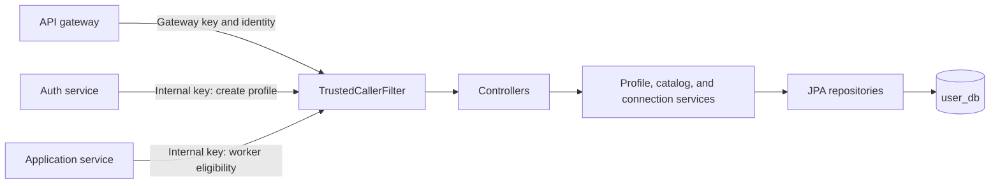
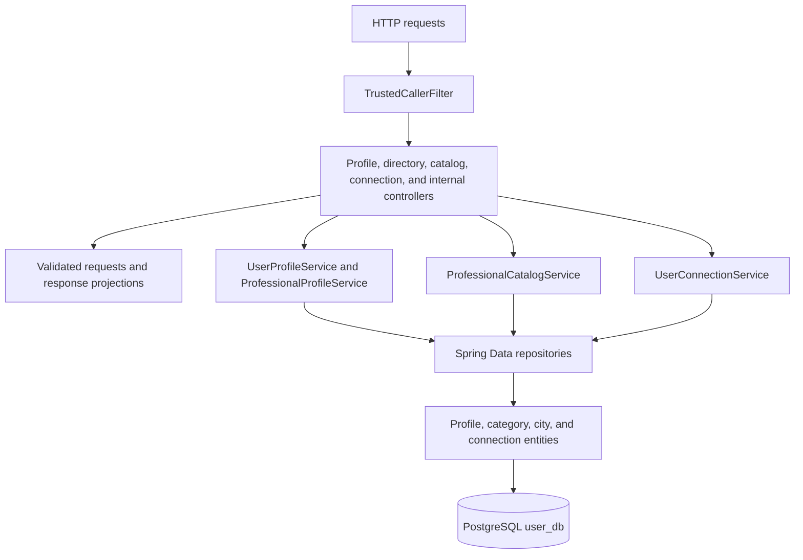
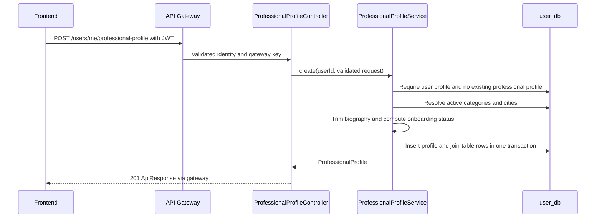
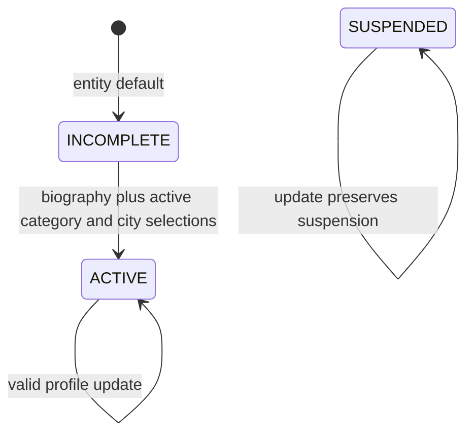
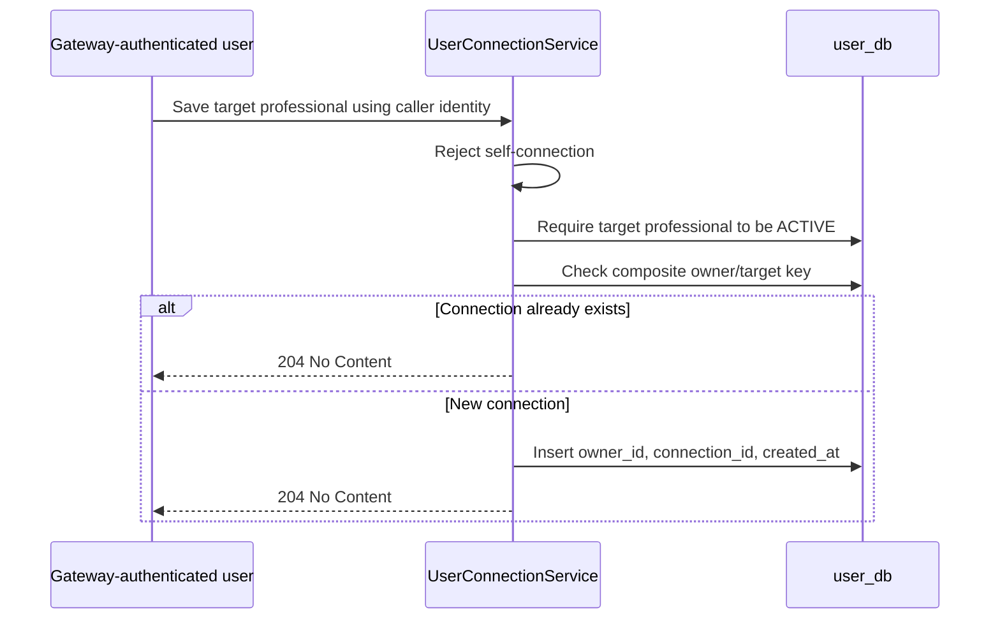
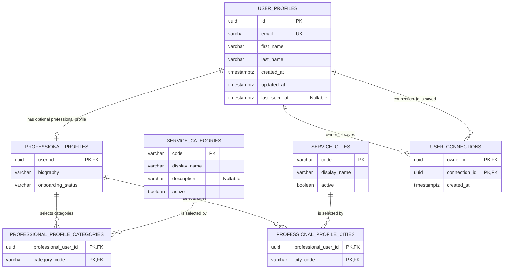

# User Service: End-to-End Architecture

This document traces the current implementation from its HTTP boundary through
authorization, service behavior, data relationships, and runtime dependencies.
The numbered structure follows [Job Service: End-to-End Architecture](../../docs/development/job-service-architecture.md).

## 1. Responsibility

`user-service` owns personal profiles, professional onboarding, service categories and cities,
the professional directory, presence timestamps, and each user's saved professional connections.
It also answers internal worker-eligibility checks. Credentials and JWTs belong to
[auth-service](../auth-service/architecture.md).

The service uses Java 21, Spring Boot 4, Spring MVC, Bean Validation, Spring Data JPA, Flyway,
PostgreSQL, and Eureka. Its default port is `8082`, registry name is `user-service`, and database
is `user_db`. Dependency versions are in [pom.xml](pom.xml).

## 2. System Context



Auth-service supplies account identities during registration. Application-service asks whether
a user has an active professional profile. The user service has no outbound business-service client.

## 3. Layered Architecture



Source root: [src/main/java/com/herafi/user_service](src/main/java/com/herafi/user_service).

| Package | Responsibility |
| --- | --- |
| `controller` | Personal/professional profiles, directory, catalog, connections, and internal APIs. |
| `service` | `UserProfileService`, `ProfessionalProfileService`, `ProfessionalCatalogService`, and `UserConnectionService`. |
| `config` | `TrustedCallerFilter` validates the caller's gateway or internal service key. |
| `entity`, `repository` | Profile, category, city, and connection persistence and directory queries. |
| `dto` | Validated requests, profile/card projections, `ApiResponse`, and `PageResponse`. |
| `exception` | Domain exceptions and `GlobalExceptionHandler`. |

Controllers bind identity headers and DTOs, then select response envelopes and status codes.
Services enforce profile/catalog/connection rules in local transactions. DTO `from` methods
build public or owner-facing projections, and directory/connection controllers compute one
online cutoff per response. Repositories handle directory selection and relationship loading.

## 4. Public API

The gateway authenticates every `/users/**` route, including directory and catalog reads.
`TrustedCallerFilter` checks `X-Gateway-Key` for `/users/` paths and `X-Internal-Api-Key` for
`/internal/` paths. This service does not decode JWTs. Self-service operations take their owner
UUID from the gateway's `X-User-Id` header.

| Method | Path | Purpose |
| --- | --- | --- |
| `GET`, `PUT` | `/users/me` | Read a personal profile or update first and last names. |
| `POST` | `/users/me/heartbeat` | Set `lastSeenAt`; return `204`. |
| `POST`, `GET`, `PUT` | `/users/me/professional-profile` | Create, read, or update professional details. |
| `GET` | `/users/categories`, `/users/cities` | List active catalog entries. |
| `GET` | `/users/professionals` | Page through active professionals, optionally filtering category/city. |
| `GET` | `/users/professionals/{userId}` | Read an active professional's public projection. |
| `GET` | `/users/me/connections` | List the caller's saved, currently active professionals. |
| `POST`, `DELETE` | `/users/me/connections/{targetId}` | Add/remove a connection; return `204`. |
| `POST` | `/internal/users` | Create a profile using the account UUID supplied by auth-service. |
| `GET` | `/internal/users/{userId}/worker-eligibility` | Return `{userId, eligible}` for internal callers. |
| `GET` | `/actuator/health` | Service health. |

Most successful JSON responses use `{success: true, data: ...}`. Worker eligibility returns its
record directly, and heartbeat/connection writes have no response body. Directory pagination
defaults to 12 entries sorted by `userId`; the configured maximum page size is 20.

## 5. Profile Creation and Onboarding

Personal profile creation is internal-only: auth-service posts the account UUID, email, and
names to `/internal/users`. `UserProfileService` rejects duplicate UUID/email, normalizes the
email, trims names, and persists audit timestamps through entity callbacks.

An authenticated user then creates a professional profile:

```json
{
  "biography": "Plumber available for household repairs.",
  "categoryCodes": ["PLUMBING"],
  "cityCodes": ["CASABLANCA"]
}
```



The caller's `X-User-Id` selects the profile; the request body cannot select a different owner.
Updating `/users/me` changes names only. Updating the professional profile replaces the biography
and selected category/city sets after resolving active codes.

## 6. Directory, Presence, and Privacy

`GET /users/professionals` returns only `ACTIVE` professionals, optionally filtered by
`categoryCode` and `cityCode`. Directory paging defaults to 12 rows, with a configured maximum
of 20. Single-profile directory reads also require active status.

`PublicProfessionalProfileResponse` and `ProfessionalCardResponse` define directory projections;
`UserProfileResponse` and `ProfessionalProfileResponse` serve the owner's account views. The
gateway requires authentication even for the directory's public-profile projection.

`POST /users/me/heartbeat` writes `lastSeenAt`. Directory and connection responses compare that
timestamp with one request-wide cutoff derived from `ONLINE_THRESHOLD` (default `2m`). A user
without a recent timestamp is offline. There is no WebSocket session or separate presence table.

## 7. Onboarding and Connection Rules

### Profiles and professional onboarding

Auth-service creates personal profiles through the internal API. `UserProfileService` rejects
duplicate IDs/emails, normalizes email, and trims names. Public profile updates change names only.

Professional profiles share the personal profile's UUID. Creation requires an existing user and
rejects a second professional profile. Category/city codes are trimmed, uppercased, and resolved
against active catalog entries. A nonblank biography plus nonempty category and city selections
activates a profile unless it is `SUSPENDED`. Stored states are `INCOMPLETE`, `ACTIVE`, and
`SUSPENDED`; there is no suspension-management controller in the current implementation.

The directory exposes only `ACTIVE` profiles. Internal worker eligibility checks the same state;
it does not rely on the account's JWT role. Heartbeats persist `lastSeenAt`, and directory and
connection responses compute online status using the configured recency threshold (two minutes
by default). Presence is derived from timestamps, without a WebSocket or separate presence store.

### Connections

Connections are directional: saving another user creates only the caller-to-target relationship.
The target must be an active professional and cannot be the caller. Repeating an existing save
returns successfully; removing a missing connection returns `404`. Listing hides professionals
who have become inactive while retaining their saved rows.



This diagram describes `applyOnboardingStatus`, not an administrative moderation workflow.
The current HTTP API has no operation that sets `SUSPENDED`; it preserves that state if stored.
The database permits empty relationship sets, while create/update validation requires selections.

## 8. Internal Integration and Connection Flow



`GET /internal/users/{userId}/worker-eligibility` returns `{userId, eligible}`. A missing or
non-active professional profile yields `eligible: false`. `InternalWorkerController` requires
the internal key through `TrustedCallerFilter`; a claimed JWT role is not sufficient.

Profile IDs are supplied by auth-service through the internal create API. No cross-database join
or synchronous auth-service lookup is performed when reading or updating a profile.

## 9. Persistence Model

The diagram shows the final Flyway schema in `user_db`. `PK` means primary key, `FK` means
foreign key, and `UK` means a unique column. Join tables use composite primary keys.



### Entity relationships

| Relationship | JPA / database implementation | Cardinality |
| --- | --- | --- |
| Personal to professional profile | `@OneToOne` with `@MapsId`; `user_id` is both PK and FK. | One user has zero or one professional profile. |
| Professional to categories | `@ManyToMany` through `professional_profile_categories`. | Many professionals can select many categories. |
| Professional to cities | `@ManyToMany` through `professional_profile_cities`. | Many professionals can select many cities. |
| User to saved users | `UserConnection` with `@IdClass(UserConnectionId)`; SQL enforces both user FKs. | Many directional connections per owner and per target. |

`UserConnectionId` is a composite-key class, not another table. `ProfessionalOnboardingStatus`
is a string enum, not an entity. Join tables are managed by JPA associations, without dedicated
Java entity classes. Professional and connection rows cascade on user deletion; catalog references
use `ON DELETE RESTRICT`. Connection rows reject `owner_id = connection_id`.

Flyway migrations live in [src/main/resources/db/migration](src/main/resources/db/migration).

| Table | Data and relationships |
| --- | --- |
| `user_profiles` | Account UUID, unique email, names, audit timestamps, and `last_seen_at`. |
| `professional_profiles` | One row per user, biography, and onboarding status; FK to `user_profiles`. |
| `service_categories`, `service_cities` | Locally owned catalogs keyed by code, with active flags. |
| `professional_profile_categories`, `professional_profile_cities` | Join tables for professional selections. |
| `user_connections` | Composite key `(owner_id, connection_id)`, creation time, two user FKs, and a no-self check. |

Service methods use local transactions; JPA validates the Flyway-managed schema and open-in-view
is disabled. User UUIDs are shared with auth-service through API contracts, without cross-database
foreign keys. This service makes no outbound business-service HTTP calls. Its catalogs are
separate from job-service's `skills` and `cities`; no automatic synchronization is implemented.

| Migration | Change |
| --- | --- |
| `V1__create_user_profiles.sql` | Personal profile and unique email. |
| `V2__create_professional_profiles.sql` | Shared-key professional profile and status constraint. |
| `V3__create_service_categories.sql` | Categories, join table, and seed data. |
| `V4__create_service_cities.sql` | Empty migration retained in history. |
| `V5__create_service_cities.sql` | Cities, join table, and seed data. |
| `V6__add_last_seen_to_user_profiles.sql` | Presence timestamp. |
| `V7__create_user_connections.sql` | Directional connections and reverse-lookup index. |

## 10. Error Boundary

`GlobalExceptionHandler` returns `{success: false, error: {code, message, errors}}`.
`TrustedCallerFilter` writes the same envelope shape when a key is invalid.

| Condition | HTTP | Code |
| --- | ---: | --- |
| Invalid DTO fields | 400 | `VALIDATION_ERROR` |
| Invalid/inactive category or city | 400 | `INVALID_CATALOG_CODE` |
| Saving oneself | 400 | `SELF_CONNECTION_NOT_ALLOWED` |
| Target is not an active professional | 400 | `NOT_A_PROFESSIONAL` |
| Invalid gateway key | 401 | `UNTRUSTED_GATEWAY` |
| Invalid internal key | 401 | `UNAUTHORIZED_INTERNAL_REQUEST` |
| Missing identity header | 401 | `MISSING_USER_IDENTITY` |
| Missing personal/professional profile | 404 | `USER_PROFILE_NOT_FOUND` / `PROFESSIONAL_PROFILE_NOT_FOUND` |
| Removing a missing connection | 404 | `CONNECTION_NOT_FOUND` |
| Existing personal/professional profile | 409 | `USER_PROFILE_ALREADY_EXISTS` / `PROFESSIONAL_PROFILE_ALREADY_EXISTS` |
| Duplicate email / caught integrity violation | 409 | `PROFILE_EMAIL_ALREADY_IN_USE` |

The generic integrity-violation mapping uses the email-conflict code even when the violated
constraint concerns another relationship; this is a current limitation of error translation.

## 11. Configuration and Local Runtime

Configuration source: [application.properties](src/main/resources/application.properties).

| Environment variable | Purpose / default |
| --- | --- |
| `SERVER_PORT` | HTTP port; `8082`. |
| `DB_URL` | JDBC URL; `jdbc:postgresql://localhost:5432/user_db`. |
| `DB_USERNAME`, `DB_PASSWORD` | Required database credentials. |
| `GATEWAY_SHARED_SECRET` | Required key for gateway-originated requests. |
| `INTERNAL_API_KEY` | Required key for internal callers. |
| `DISCOVERY_SERVICE_URL` | Eureka endpoint; `http://localhost:8761/eureka/`. |
| `ONLINE_THRESHOLD` | Presence recency window; `2m`. |
| `SHOW_SQL` | SQL logging; `true`. |

Run `mvn spring-boot:run` from this directory with PostgreSQL, discovery, and the required
configuration. The [Compose file](../../infra/docker/docker-compose.yml) supplies development
wiring and starts this container after PostgreSQL, auth-service, and discovery are healthy.

Run `mvn test`. Existing tests cover controllers, profile validation, onboarding, catalogs,
directory presence, internal worker eligibility, and connections. Persistence/context tests use
the H2-backed `test` profile. See [src/test](src/test).

## 12. Developer Change Guide

1. Define field validation and public projections in DTOs; keep credential data out of this service.
2. Keep onboarding, catalog validation, presence, and connection rules in their respective services.
3. Preserve the shared user/professional UUID and the directional connection composite key.
4. Use a new Flyway migration for schema or catalog changes.
5. Keep caller identity derived from gateway headers and protect internal APIs with the internal key.
6. Update worker-eligibility consumers when changing the meaning of ACTIVE.

Run `mvn test`. Existing tests cover controllers, validation, catalogs, onboarding, presence,
connections, and worker eligibility. H2 persistence/context tests use the `test` profile.

## 13. Open Decisions and Risks

- Profile creation and auth credential creation have separate transactions.
- Professional categories/cities and job-service reference codes are independently seeded.
- No moderation endpoint currently exposes suspension or reactivation.
- Existing connection saves are idempotent after the existence check; simultaneous first saves still
  rely on the composite primary key and the broad integrity-error mapping.
- Connection listing is unpaginated, and presence is based on client heartbeats rather than live sessions.

## 14. Source Map

Java source root: [src/main/java/com/herafi/user_service](src/main/java/com/herafi/user_service).

| Concern | Primary files |
| --- | --- |
| Trusted callers | [config/TrustedCallerFilter.java](src/main/java/com/herafi/user_service/config/TrustedCallerFilter.java) |
| Personal profiles | [controller/UserProfileController.java](src/main/java/com/herafi/user_service/controller/UserProfileController.java), [service/UserProfileService.java](src/main/java/com/herafi/user_service/service/UserProfileService.java) |
| Onboarding | [controller/ProfessionalProfileController.java](src/main/java/com/herafi/user_service/controller/ProfessionalProfileController.java), [service/ProfessionalProfileService.java](src/main/java/com/herafi/user_service/service/ProfessionalProfileService.java) |
| Directory | [controller/ProfessionalDirectoryController.java](src/main/java/com/herafi/user_service/controller/ProfessionalDirectoryController.java), [repository/ProfessionalProfileRepository.java](src/main/java/com/herafi/user_service/repository/ProfessionalProfileRepository.java) |
| Catalog | [service/ProfessionalCatalogService.java](src/main/java/com/herafi/user_service/service/ProfessionalCatalogService.java) |
| Connections | [service/UserConnectionService.java](src/main/java/com/herafi/user_service/service/UserConnectionService.java), [entity/UserConnection.java](src/main/java/com/herafi/user_service/entity/UserConnection.java) |
| Internal APIs | [controller/InternalUserController.java](src/main/java/com/herafi/user_service/controller/InternalUserController.java), [controller/InternalWorkerController.java](src/main/java/com/herafi/user_service/controller/InternalWorkerController.java) |
| Relationships | [entity/ProfessionalProfile.java](src/main/java/com/herafi/user_service/entity/ProfessionalProfile.java), [entity/UserConnectionId.java](src/main/java/com/herafi/user_service/entity/UserConnectionId.java) |
| Errors | [exception/GlobalExceptionHandler.java](src/main/java/com/herafi/user_service/exception/GlobalExceptionHandler.java) |

Runtime properties: [application.properties](src/main/resources/application.properties).
