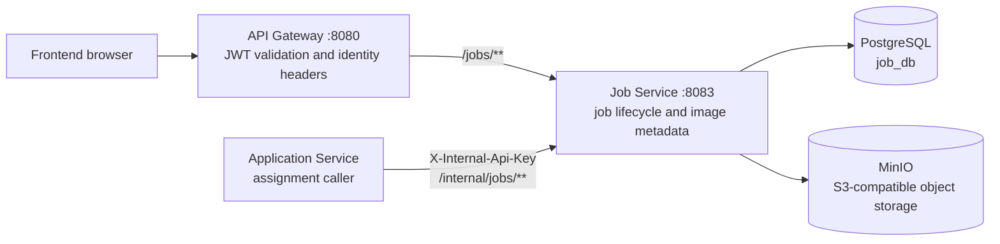
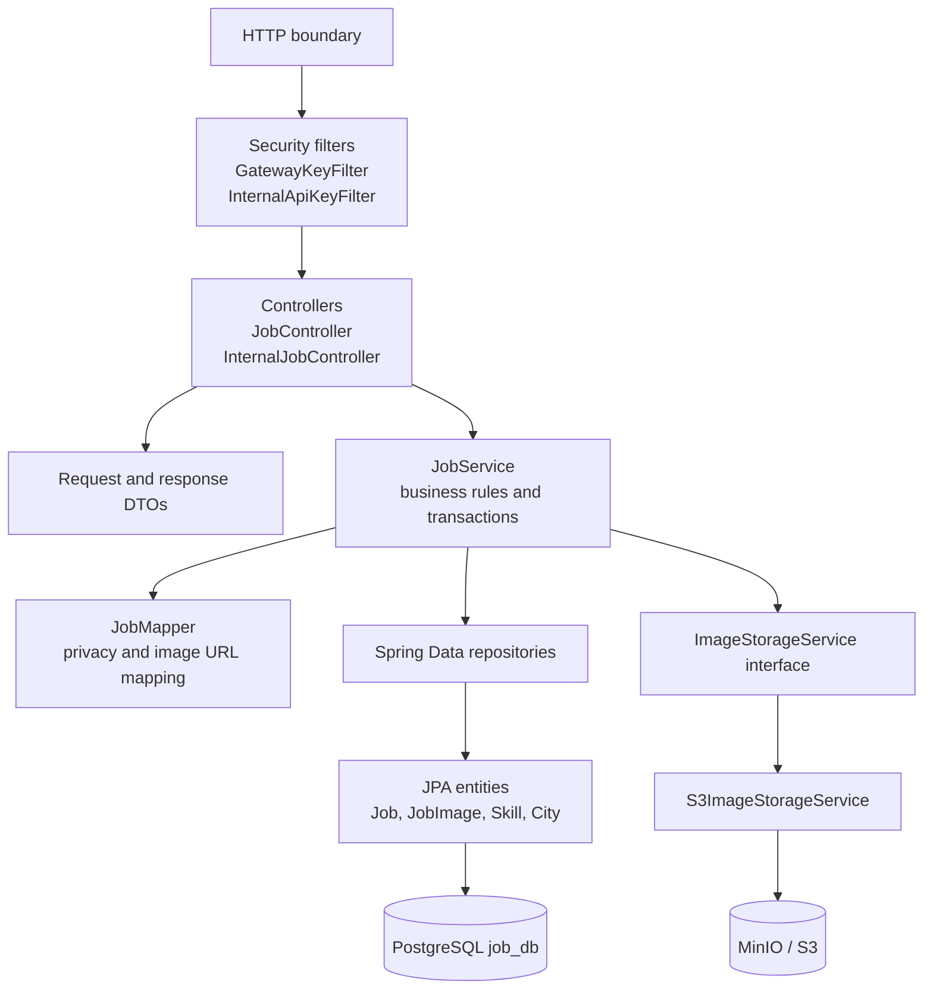
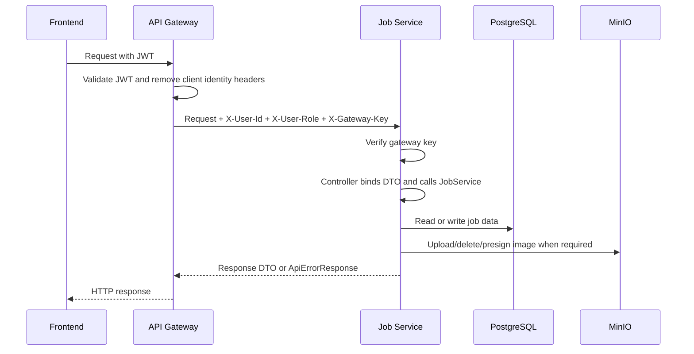
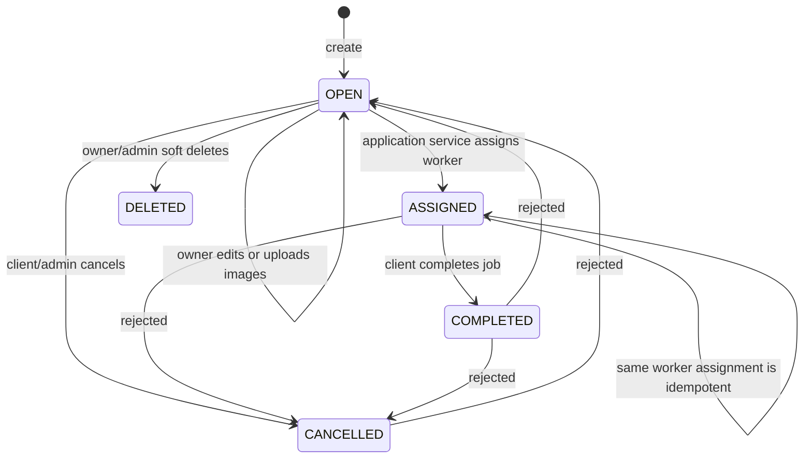
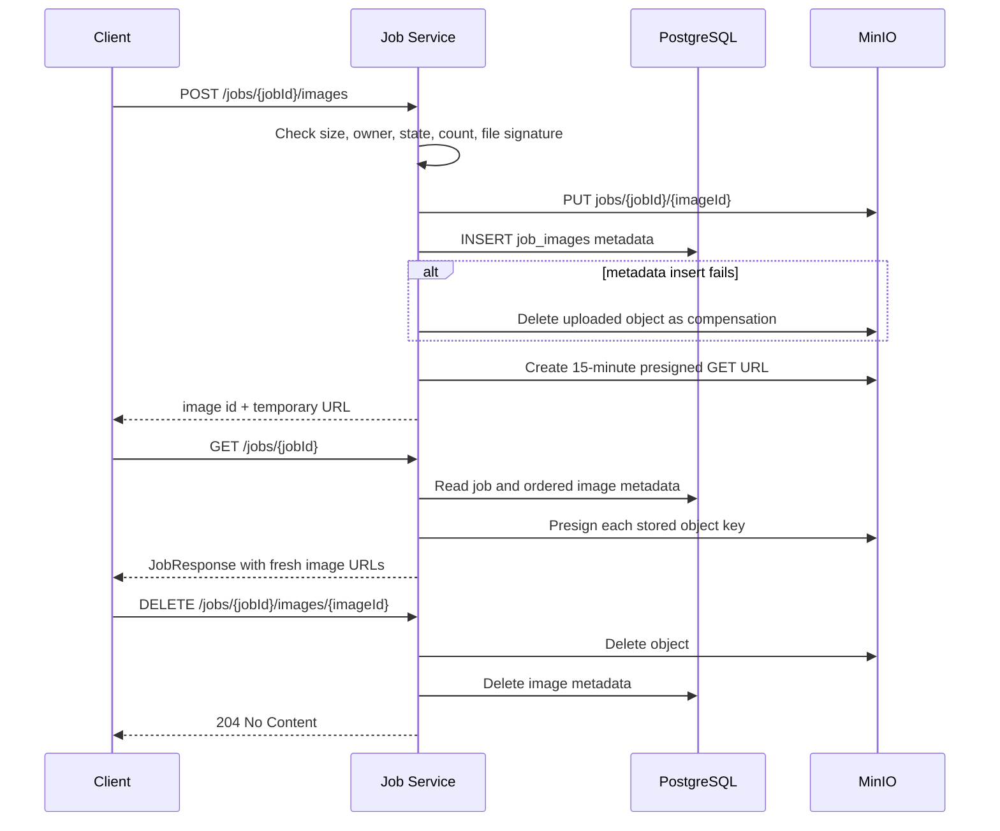
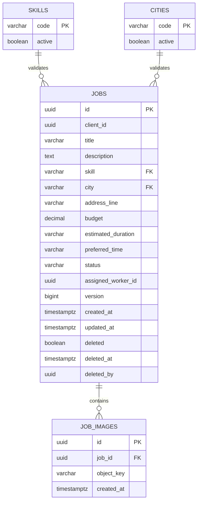

# Job Service: End-to-End Architecture

This document explains the current `backend/job-service` implementation from an
HTTP request through business rules, persistence, and object storage. It is the
main orientation document for developers working on the service.

## 1. Responsibility

The job service owns:

- Job creation and editing.
- Job search and filtering.
- Job lifecycle state.
- Ownership checks for client actions.
- Assignment state received from the application service.
- Job image metadata and the corresponding MinIO objects.
- Fixed reference data for skills and cities.

It does not own:

- Authentication, JWT issuance, or user profiles.
- Worker applications.
- Reviews, ratings, or chat messages.
- User names, email addresses, or avatars.

The service stores a `clientId` and an `assignedWorkerId` as UUIDs. The user and
application services remain responsible for the meaning of those UUIDs.

## 2. System Context

Normal browser traffic follows this path:



The gateway validates the user's JWT, removes client-supplied identity headers,
and injects trusted values before forwarding a request to the job service. The
job service verifies the shared gateway key independently.

The application service is expected to call the internal assignment and summary
endpoints. Assignment is not initiated by a worker-facing public endpoint in
this service.

## 3. Layered Architecture



### HTTP and filter layer

`GatewayKeyFilter` protects `/jobs` and `/jobs/**`. It requires
`X-Gateway-Key` to match `gateway.shared-secret` using a constant-time byte
comparison. It does not authenticate a user itself; it authenticates the
gateway-to-service hop.

`InternalApiKeyFilter` protects `/internal` and `/internal/**`. It requires
`X-Internal-Api-Key` to match `service.security.internal-api-key`.

Both filters return the common JSON error shape through `ApiErrorWriter` and do
not continue the request when the key is invalid.

Actuator health is outside both path filters so Docker can call
`/actuator/health` without user or service identity headers.

### Controller layer

Controllers translate HTTP into typed method calls. They are responsible for:

- Reading identity and role headers.
- Binding path variables, query parameters, JSON, and multipart files.
- Applying `@Valid`, `@Min`, and `@Max` constraints.
- Selecting HTTP status codes.
- Never deciding ownership or lifecycle rules themselves.

`JobController` serves public gateway-routed job operations. `InternalJobController`
serves service-to-service operations and is protected by the internal API key
filter.

### DTO layer

DTOs define the API boundary and prevent entities from becoming request bodies.
Important DTOs are:

| DTO | Purpose |
| --- | --- |
| `CreateJobRequest` | New job fields with validation. |
| `UpdateJobRequest` | Editable title, description, and address fields. |
| `JobFilter` | Search filters. |
| `AssignWorkerRequest` | Internal worker UUID. |
| `JobListResponse` | Search response without private address or image URLs. |
| `JobResponse` | Job response, including conditional address and detail images. |
| `JobSummaryResponse` | Minimal internal job state. |
| `JobImageResponse` | Image UUID and temporary download URL. |
| `PageResponse` | Page content and pagination metadata. |

### Service layer

`JobService` owns business behavior. It sets server-controlled fields, validates
reference data, checks ownership, enforces state transitions, coordinates
database writes, and calls image storage.

Methods that mutate jobs or image metadata use `@Transactional`. JPA dirty
checking persists changes made to a managed `Job`; assignment explicitly calls
`save` so the optimistic-lock conflict is surfaced at the assignment boundary.
Image uploads lock the parent job with `PESSIMISTIC_WRITE`, check the count, and
flush the metadata insert in the same transaction so concurrent uploads cannot
exceed the configured cap.

### Repository layer

Repositories use Spring Data JPA. `JobRepository` also implements
`JpaSpecificationExecutor` so search predicates can be composed by
`JobSpecification`.

Repository rules currently used by the service:

- Public reads use `findByIdAndDeletedFalse`.
- “My jobs” uses `findByClientIdAndDeletedFalse`.
- Search begins with `JobSpecification.isNotDeleted()`.
- Image counts use `countByJob_Id`.
- Image detail ordering uses `@OrderBy("createdAt ASC")` on `Job.images`.

### Storage layer

`ImageStorageService` hides S3 operations behind three actions:

- `upload(objectKey, stream, size, contentType)`
- `generateDownloadUrl(objectKey)`
- `delete(objectKey)`

`S3ImageStorageService` implements the interface with the AWS SDK. The S3
client uses the internal endpoint; the presigner uses the browser-facing public
endpoint.

## 4. Public API

All public routes require the gateway key:

```text
X-Gateway-Key: <gateway shared secret>
```

User-scoped routes additionally require the gateway-provided `X-User-Id` header.
Routes that use a role also require the gateway-provided `X-User-Role` header.
Clients should normally call the gateway at `http://localhost:8080`, not the
job-service port directly.

| Method | Path | Purpose | Main authorization |
| --- | --- | --- | --- |
| `POST` | `/jobs` | Create a job | Authenticated identity creates `clientId`. |
| `GET` | `/jobs` | Search jobs | Gateway-authenticated request. |
| `GET` | `/jobs/{id}` | Get job detail | Address is owner/worker-only. |
| `GET` | `/jobs/my` | List current user's jobs | `X-User-Id` selects client. |
| `PUT` | `/jobs/{id}` | Edit an open job | Job owner only. |
| `PATCH` | `/jobs/{id}/complete` | Complete assigned job | Job owner only. |
| `PATCH` | `/jobs/{id}/cancel` | Cancel open job | Owner or `ADMIN`. |
| `DELETE` | `/jobs/{id}` | Soft-delete job | Owner or `ADMIN`; assigned jobs rejected. |
| `GET` | `/jobs/skills` | List active skill codes | Gateway-authenticated request. |
| `GET` | `/jobs/cities` | List active city codes | Gateway-authenticated request. |
| `POST` | `/jobs/{jobId}/images` | Upload job image | Owner, open job, image limit. |
| `DELETE` | `/jobs/{jobId}/images/{imageId}` | Delete job image | Job owner only. |

### Request and response flow



## 5. Job Creation

`POST /jobs` accepts:

```json
{
  "title": "Fix kitchen sink",
  "description": "The sink is leaking.",
  "skill": "PLUMBING",
  "city": "CASABLANCA",
  "addressLine": "123 Main Street",
  "budget": 300.00,
  "estimatedDuration": "HALF_DAY",
  "preferredTime": "MORNING"
}
```

The service performs this sequence:

1. Validate that `skill` is present and active in `skills`.
2. Validate that `city` is present and active in `cities`.
3. Copy user-editable fields from the request.
4. Copy `X-User-Id` into `clientId`.
5. Apply defaults: `OPEN` status and `ANYTIME` preferred time.
6. Let JPA assign UUID and timestamps through entity callbacks.
7. Save the job.

The request cannot control `id`, `clientId`, `status`, `assignedWorkerId`,
`version`, `deleted`, or timestamps.

## 6. Search and Privacy

`GET /jobs` accepts these optional filters:

```text
skill
city
status
minBudget
maxBudget
duration
preferredTime
```

Supported sorting is limited to:

```text
createdAt, budget, title
```

The default is `createdAt,desc`. Page size is limited to 20 by the controller.
Search always excludes soft-deleted jobs and returns `JobListResponse`.

`JobListResponse` intentionally excludes `addressLine` and image URLs. Detail
requests return `JobResponse`; the mapper includes the address only when the
viewer is the job client or assigned worker.

Detail image URLs are generated from persisted `JobImage.objectKey` values on
each request. They are presigned for 15 minutes, so the frontend must not treat
them as permanent URLs.

## 7. Lifecycle and State Rules



`DELETED` is a documentation state, not a value in `JobStatus`. It is represented
by `deleted = true` and is excluded from normal reads.

Rules:

- Only `OPEN` jobs can be edited.
- Only `OPEN` jobs can receive images.
- Only `ASSIGNED` jobs can be completed.
- Assignment requires `OPEN` and sets both status and worker UUID.
- A repeated assignment for the same worker is idempotent.
- A repeated or conflicting assignment returns `JOB_NOT_OPEN` / HTTP 409.
- Cancellation requires `OPEN` and sets `CANCELLED`.
- Soft deletion preserves the job row and rejects deletion of assigned jobs.
- Optimistic locking prevents stale concurrent assignment updates from both
  succeeding.

The application service supplies the worker assignment through:

```http
PATCH /internal/jobs/{id}/assign
X-Internal-Api-Key: <internal service key>
Content-Type: application/json

{"workerId":"<worker-uuid>"}
```

The internal summary and chat-eligibility routes are:

```text
GET /internal/jobs/{id}/summary
GET /internal/jobs/{id}/chat-eligibility
```

Chat is currently eligible when the job is `ASSIGNED` or `COMPLETED`. The
response contains the client UUID; the caller resolves user details elsewhere.

## 8. Image Lifecycle



Current upload rules:

- Maximum file size is `10MB`.
- Maximum images per job is `10`.
- The job must not be soft-deleted.
- The job must be `OPEN`.
- The authenticated user must own the job.
- The accepted signatures are JPEG, PNG, and WebP.
- The submitted MIME type is not trusted for content classification.
- SVG is not accepted.
- Image order is `createdAt` ascending; there is no position column.

The object key is generated by the service as:

```text
jobs/{jobId}/{imageId}
```

The database stores the object key, not the temporary URL. This is what allows a
detail request after a page reload to create a new valid URL.

Deletion currently removes the S3 object first and then the database row. If the
storage delete succeeds but the database delete fails, the row can temporarily
refer to a missing object. This is an operational consistency risk to address if
image deletion must be fully retryable.

## 9. Persistence Model



Flyway migrations are in:

```text
backend/job-service/src/main/resources/db/migration/
```

Current migration history:

| Migration | Change |
| --- | --- |
| `V1__init_jobs.sql` | Core tables, foreign keys, indexes, and state constraints. |
| `V2__seed_job_reference_data.sql` | Initial skills and cities. |
| `V3__add_soft_delete.sql` | Soft-delete fields on `jobs`. |
| `V4__create_job_images.sql` | Image metadata table. |
| `V5__add_job_version.sql` | Optimistic-lock version column. |
| `V6__remove_job_image_position.sql` | Removes position and adds created-time index. |

Hibernate uses `ddl-auto=validate`; schema changes must be made through a new
Flyway migration. The database constrains budget positivity, valid enum strings,
reference keys, and the relationship between job status and assigned worker.

## 10. Error Boundary

The `GlobalExceptionHandler` and security filters expose a common
`ApiErrorResponse` shape:

```json
{
  "timestamp": "2026-09-04T12:00:00Z",
  "status": 409,
  "code": "INVALID_STATE",
  "message": "Only open jobs can be cancelled",
  "path": "/jobs/<id>/cancel"
}
```

Validation errors may also contain `fieldErrors`.

| Condition | HTTP | Code |
| --- | ---: | --- |
| Invalid DTO fields | 400 | `VALIDATION_ERROR` |
| Malformed body or UUID | 400 | `INVALID_REQUEST` |
| Invalid page parameters | 400 | `INVALID_PAGINATION` |
| Invalid sort field/direction | 400 | `INVALID_SORT` |
| Unknown or inactive skill/city | 400 | `INVALID_REFERENCE` |
| Empty, invalid, or oversized image | 400 / 413 | `INVALID_IMAGE` |
| Missing or invalid gateway/internal key | 401 | `UNAUTHORIZED` |
| Non-owner action | 403 | `NOT_OWNER` |
| Missing active job or image | 404 | `JOB_NOT_FOUND` |
| Invalid lifecycle state | 409 | `INVALID_STATE` or `JOB_NOT_OPEN` |
| Unexpected failure | 500 | `INTERNAL_ERROR` |

The response code is the client contract. Clients should not branch on the
human-readable message.

## 11. Configuration and Local Runtime

Main configuration is in
`backend/job-service/src/main/resources/application.properties`.

| Property | Default / Docker value | Meaning |
| --- | --- | --- |
| `server.port` | `8083` | Job service HTTP port. |
| `spring.datasource.url` | `jdbc:postgresql://localhost:5432/job_db` | Job database. |
| `gateway.shared-secret` | Development default | Gateway-to-job-service key. |
| `service.security.internal-api-key` | Development default | Service-to-service key. |
| `aws.s3.endpoint` | `http://minio:9000` | Internal S3 client endpoint. |
| `aws.s3.public-endpoint` | `http://localhost:9000` | Browser-facing presigned URL endpoint. |
| `aws.s3.bucket` | `jobs` | Object bucket. |
| `jobs.images.max-file-size` | `10MB` | Application and multipart limit. |
| `jobs.images.max-count` | `10` | Images allowed per job. |

Docker Compose provides:

- PostgreSQL with `job_db` created by the initialization scripts.
- MinIO on ports `9000` and `9001`.
- `minio-init`, which waits for MinIO health and creates the `jobs` bucket.
- Job service startup after `minio-init` completes successfully.
- API gateway on port `8080`.

For the local Docker flow:

```bash
docker compose -f infra/docker/docker-compose.yml up --build
```

When running the job service outside Docker while MinIO remains in Docker, set
the S3 endpoint to a host-reachable value, for example:

```bash
S3_ENDPOINT=http://localhost:9000
S3_PUBLIC_ENDPOINT=http://localhost:9000
```

Development secrets in Compose are not production secrets. Production
deployment must inject all credentials and must not expose port `8083` directly
to untrusted clients.

## 12. Developer Change Guide

Use these ownership rules when changing behavior:

1. Add or change an HTTP contract in a DTO and controller.
2. Put authorization, state, and consistency rules in `JobService`.
3. Add database access to a repository only when an existing query cannot express
   the requirement.
4. Change schema through a new Flyway migration; never edit an applied migration.
5. Keep image provider details behind `ImageStorageService`.
6. Keep privacy decisions in `JobMapper` or a dedicated response-mapping layer,
   not in frontend code.
7. Use fresh presigned URLs for returned image metadata; never persist a URL.
8. Preserve the distinction between public `/jobs/**` and internal
   `/internal/**` routes.

## 13. Open Decisions and Risks

These items are not silently solved by the current implementation:

- `EstimatedDuration` currently supports `HALF_DAY`, `FULL_DAY`, and `MULTI_DAY`.
  The draft specification mentions `UNDER_2H`; the API and database must be
  decided together before adding it.
- Coordinates are not stored. Adding latitude/longitude would affect privacy,
  validation, search, and the database migration.
- Direct port `8083` exposure is acceptable for local development only. A
  production deployment should restrict network access to the gateway and
  trusted service callers.
- Gateway headers are trusted only after the shared key is verified. The shared
  key must therefore remain private to the gateway and job service.
- Image upload compensates for a metadata-save failure, but external storage
  and database operations are not one atomic transaction.
- Image deletion has the reverse consistency risk if object deletion succeeds
  and metadata deletion fails.
- Soft-deleting a job hides its images from the API, but does not currently
  remove the associated MinIO objects automatically.
- The current image check validates magic bytes. Full image decoding and image
  dimension/pixel limits are future hardening options.
- Skills and cities are fixed, migration-managed reference data. Admin-managed
  vocabulary would require a separate authorization and lifecycle design.

## 14. Source Map

Start here when tracing a change:

| Concern | Primary files |
| --- | --- |
| Public endpoints | `controller/JobController.java` |
| Internal endpoints | `controller/InternalJobController.java` |
| Business rules | `service/JobService.java` |
| Object storage | `service/ImageStorageService.java`, `service/S3ImageStorageService.java` |
| S3 endpoints | `config/S3Config.java` |
| Gateway security | `config/GatewayKeyFilter.java` |
| Internal security | `config/InternalApiKeyFilter.java` |
| Response privacy | `mapper/JobMapper.java` |
| Job persistence | `entity/Job.java`, `repository/JobRepository.java` |
| Image persistence | `entity/JobImage.java`, `repository/JobImageRepository.java` |
| Search predicates | `specification/JobSpecification.java` |
| API errors | `exceptions/GlobalExceptionHandler.java`, `config/ApiErrorWriter.java` |
| Schema | `src/main/resources/db/migration/*.sql` |
| Local dependencies | `infra/docker/docker-compose.yml` |
