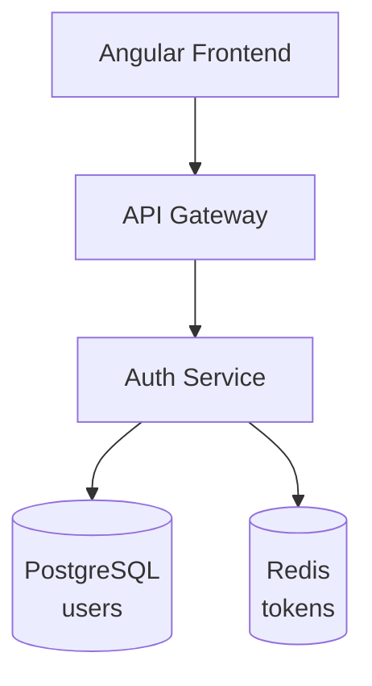

# Auth Spec

## 1. Overview

This document describes the design and implementation of the authentication
system for the platform. It covers the technical decisions, architecture,
and detailed specifications for both frontend and backend.

### Scope

- Email and password based authentication
- JWT access token + opaque refresh token strategy
- Role based access control (USER, ADMIN)
- Token rotation
- Multi-device login support

### Out of Scope (for now)

- Google OAuth (planned later)
- Logout from all devices
- Active session management
- Account deactivation
- Password reset flow
- Email verification

---

## 2. Tech Stack

| Layer         | Technology                 |
| ------------- | -------------------------- |
| Frontend      | Angular                    |
| Backend       | Spring Boot (Auth Service) |
| Database      | PostgreSQL                 |
| Cache         | Redis                      |
| Access Token  | JWT (15min)                |
| Refresh Token | Opaque (7 days)            |

---

## 3. HLD

### Architecture



### Auth Flows

1. **Register** → form → Auth Service → save user in PostgreSQL
2. **Login** → form → Auth Service → verify user → issue JWT + refresh token in Redis
3. **Token refresh** → refresh token → Auth Service → validate Redis → rotate → new tokens
4. **Logout** → Auth Service → delete refresh token from Redis + ban JWT in Redis
5. **Access protected route** → JWT → API Gateway validates → forward to service

---

## 4. LLD

### 4.1 Database Schema

**users**

| Column     | Type      | Constraints             |
| ---------- | --------- | ----------------------- |
| id         | UUID      | PRIMARY KEY             |
| email      | VARCHAR   | UNIQUE, NOT NULL        |
| password   | VARCHAR   | NOT NULL, bcrypt hashed |
| role       | ENUM      | 'USER', 'ADMIN'         |
| created_at | TIMESTAMP |                         |
| updated_at | TIMESTAMP |                         |

### 4.2 Redis Structure

**Refresh tokens:**

```
refresh_token:{token}  →  uuid-user-42   (TTL: 7 days)
```

**Banned access tokens:**

```
banned_token:{jti}  →  "banned"   (TTL: remaining access token lifetime)
```

Supports:

- Multiple device login
- Single device logout
- Auto expiry via TTL
- Token rotation
- Instant logout via JWT blacklist

### 4.3 JWT Structure

**Payload:**

```json
{
  "jti": "unique-token-id",
  "sub": "uuid-user-42",
  "email": "user@gmail.com",
  "role": "USER",
  "iat": 1719000000,
  "exp": 1719000900
}
```

- Algorithm: HS256
- Expiry: 15 minutes
- Stored in: frontend memory
- `jti` is used as a short unique identifier for the token instead of storing the full token string in Redis — less memory, faster lookup

### 4.4 Refresh Token

- Type: opaque (random string)
- Generation: SecureRandom → Base64 encoded
- Expiry: 7 days
- Stored in: Redis + httpOnly cookie
- Rotation: old token deleted, new token issued on every refresh

### 4.5 Response Format

All endpoints return the same unified response shape.

**Success:**

```json
{
  "success": true,
  "data": { ... }
}
```

**Validation error:**

```json
{
  "success": false,
  "error": {
    "code": "VALIDATION_ERROR",
    "message": "Validation failed",
    "errors": [{ "field": "email", "message": "Invalid email format" }]
  }
}
```

**Other errors:**

```json
{
  "success": false,
  "error": {
    "code": "EMAIL_ALREADY_IN_USE",
    "message": "Email already in use"
  }
}
```

### 4.6 API Endpoints

```
POST /auth/register
POST /auth/login
POST /auth/refresh
POST /auth/logout
GET  /auth/me
```

#### POST /auth/register

**Request Body:**

```json
{
  "email": "user@gmail.com",
  "password": "secret123",
  "firstName": "John",
  "lastName": "Doe"
}
```

**Validation Rules:**

| Field     | Rules                                       |
| --------- | ------------------------------------------- |
| email     | Valid Email format, unique, max 255 chars   |
| password  | Min 8, max 128 chars - add more rules later |
| firstName | Max 50 chars                                |
| lastName  | Max 50 chars                                |

**Success Response (201):**

```json
{
  "success": true,
  "data": {
    "accessToken": "eyJhbGciOiJIUzI1NiJ9...",
    "user": {
      "id": "uuid-user-42",
      "email": "user@gmail.com",
      "firstName": "John",
      "lastName": "Doe",
      "role": "USER"
    }
  }
}
```

> Refresh token is returned as an httpOnly cookie, not in the response body.

**Error Responses:**

| Status | Code                   | When                |
| ------ | ---------------------- | ------------------- |
| 400    | `VALIDATION_ERROR`     | Invalid fields      |
| 409    | `EMAIL_ALREADY_IN_USE` | Email already taken |

#### POST /auth/login

**Request Body:**

```json
{
  "email": "user@gmail.com",
  "password": "secret123"
}
```

**Internal Flow:**

1. Validate input
2. Find user by email in PostgreSQL
3. Compare password with bcrypt hash
4. Generate JWT access token
5. Generate opaque refresh token → store in Redis
6. Return access token + user info

**Success Response (200):**

```json
{
  "success": true,
  "data": {
    "accessToken": "eyJhbGciOiJIUzI1NiJ9...",
    "user": {
      "id": "uuid-user-42",
      "email": "user@gmail.com",
      "firstName": "John",
      "lastName": "Doe",
      "role": "USER"
    }
  }
}
```

> Refresh token is returned as an httpOnly cookie, not in the response body.

**Error Responses:**

| Status | Code                  | When                    |
| ------ | --------------------- | ----------------------- |
| 400    | `VALIDATION_ERROR`    | Invalid fields          |
| 401    | `INVALID_CREDENTIALS` | Wrong email or password |

> Never reveal which field is wrong — always return `INVALID_CREDENTIALS` for both wrong email and wrong password.

#### POST /auth/refresh

> No request body — refresh token is sent automatically via httpOnly cookie.

**Internal Flow:**

1. Extract refresh token from httpOnly cookie
2. Look up token in Redis → get user_id
3. If not found → reject
4. Delete old token from Redis
5. Generate new refresh token → store in Redis
6. Generate new JWT access token
7. Return new access token + set new refresh token cookie

**Success Response (200):**

```json
{
  "success": true,
  "data": {
    "accessToken": "eyJhbGciOiJIUzI1NiJ9..."
  }
}
```

**Error Responses:**

| Status | Code                    | When                                 |
| ------ | ----------------------- | ------------------------------------ |
| 401    | `INVALID_REFRESH_TOKEN` | Token not found, expired, or invalid |

#### POST /auth/logout

> No request body — refresh token is sent automatically via httpOnly cookie.

**Internal Flow:**

1. Extract refresh token from httpOnly cookie
2. Delete refresh token from Redis
3. Add JWT `jti` to banned list in Redis with remaining access token TTL
4. Clear httpOnly cookie
5. Return success

**Success Response (200):**

```json
{
  "success": true,
  "data": {
    "message": "Logged out successfully"
  }
}
```

> Always returns success even if token is not found — user is logged out either way.

#### GET /auth/me

> Requires JWT access token in Authorization header: `Bearer <token>`

**Internal Flow:**

1. Extract JWT from Authorization header
2. Verify JWT signature
3. Check `jti` not in banned list in Redis
4. Extract `sub` (user_id) from JWT
5. Fetch user from PostgreSQL
6. Return user info

**Success Response (200):**

```json
{
  "success": true,
  "data": {
    "id": "uuid-user-42",
    "email": "user@gmail.com",
    "firstName": "John",
    "lastName": "Doe",
    "role": "USER"
  }
}
```

**Error Responses:**

| Status | Code            | When                    |
| ------ | --------------- | ----------------------- |
| 401    | `MISSING_TOKEN` | No Authorization header |
| 401    | `INVALID_TOKEN` | Invalid or expired JWT  |

### 4.7 Security Considerations

**Rate Limiting**

- Algorithm: Token Bucket (search other algos for learning)
- Applied on: `/auth/login` and `/auth/register`
- Limit: 5 requests per minute per IP
- Exceeded: return `429 Too Many Requests`

```json
{
  "success": false,
  "error": {
    "code": "TOO_MANY_REQUESTS",
    "message": "Too many attempts, please try again later"
  }
}
```

**Password Hashing**

- Algorithm: bcrypt
- Always run bcrypt even if email not found — prevents timing attacks

**Cookie Security (For Prod)**

- Refresh token cookie flags: `HttpOnly`, `Secure`

**CORS (For Prod)**

- Only whitelist the frontend domain, never use `*`

**JWT Secret**

- Minimum 256-bit random secret
- Stored in environment variables, never hardcoded

**JWT Algorithm**

- Algorithm hardcoded on backend — never trusted from token header
- Prevents `alg:none` attack where attacker sets algorithm to `none` to bypass signature verification
- Any token with unexpected algorithm → rejected immediately

**Input Sanitization**

- All inputs validated and sanitized before processing

### 4.8 Known Limitations

- Role or account changes take up to 15min to reflect (JWT expiry window)
- No instant session invalidation (stateless JWT tradeoff)
- No reuse detection on refresh token theft

---

## 5. Alternatives Considered

### JWT vs Server-Side Sessions

**Rejected: Server-Side Sessions**

Server-side sessions store the session state in the backend (database or memory).
On every request the backend must look up the session to authenticate the user.

This creates two problems:

First, **scalability** — with multiple service replicas, every request must hit
the same session store. All replicas depend on one central session database,
creating a bottleneck as traffic grows.

Second, **microservices complexity** — in a microservices architecture, every service
would need access to the session store to authenticate requests. This creates tight
coupling between services and the session store.

JWT is stateless — the token contains all the information needed to authenticate
the user. Any service can verify it independently using only the secret key,
with no shared session store needed.

### Refresh Token as JWT vs Opaque

**Rejected: JWT refresh token**

A JWT is self-contained — the backend can verify it using only the signature,
without any database or Redis lookup.

This creates a fundamental problem for refresh tokens:

The whole point of storing refresh tokens in Redis is to be able to invalidate
them — on logout, on suspicious activity, or on password change.

But if the refresh token is a JWT, the backend can verify it without hitting Redis.
Which means even if you delete it from Redis, the token is still cryptographically
valid — nothing stops the backend from accepting it.

You would have to check Redis on every refresh request anyway to enforce invalidation,
which means the JWT properties (self-contained, stateless) bring no benefit —
you're paying the cost of a JWT (larger size, complexity) without any of the gains.

An opaque token is just a random string — meaningless without Redis.
It forces a Redis lookup every time, which is exactly what we want:
Redis is the single source of truth. Delete from Redis → token is dead. Period.

### Redis vs PostgreSQL for Token Storage

**Rejected: PostgreSQL**

Storing refresh tokens in PostgreSQL would work but adds load to the main database.
Redis is purpose-built for this use case — in-memory, built-in TTL (auto-expiry),
and extremely fast. No manual cleanup job needed for expired tokens.

### Pure Stateless JWT vs Hybrid

**Rejected: Pure stateless**

Pure stateless JWT cannot be invalidated — if a token is stolen, the attacker has
access until expiry. The hybrid approach (stateless access token + stateful refresh
token in Redis) gives the best of both worlds: fast stateless verification for every
request, with full invalidation control via Redis on logout.

### UUID vs Sequential Integer for User ID

**Rejected: Sequential Integer (AUTO_INCREMENT)**

Sequential integers expose two problems:

First, **user enumeration** — an attacker can guess user IDs (`/users/1`, `/users/2`)
and scan the system to discover existing accounts.

Second, **multiple service replicas** — with sequential integers, each replica needs
to coordinate with a central source to know the last ID and avoid duplicates.
This creates a bottleneck and a single point of failure.
With UUID, any replica generates a globally unique ID instantly without coordination.

### Token Bucket vs Other Rate Limiting Algorithms

**Rejected: Fixed Window**

Fixed window counter has a boundary attack problem — attacker can send double the
allowed requests at window boundaries. Token bucket allows controlled bursts while
enforcing a long-term rate limit, making it more suitable for auth endpoints.

---

## 6. Future Scope

- Google OAuth
- Apple OAuth
- Logout from all devices
- Active session management per device
- Reuse detection
- Account deactivation
- Password reset flow
- Email verification
